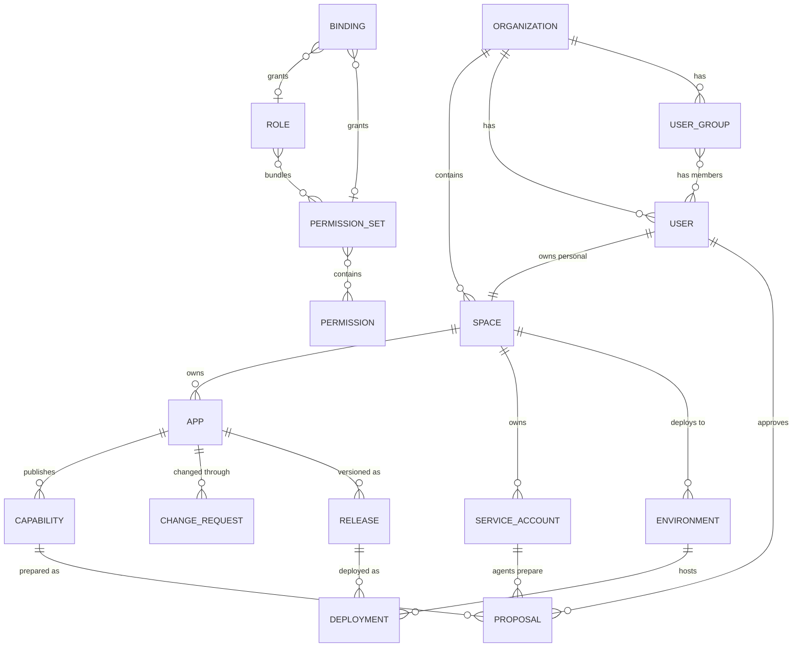
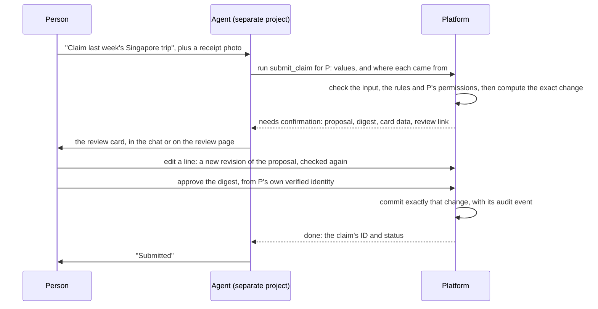
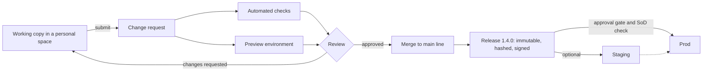
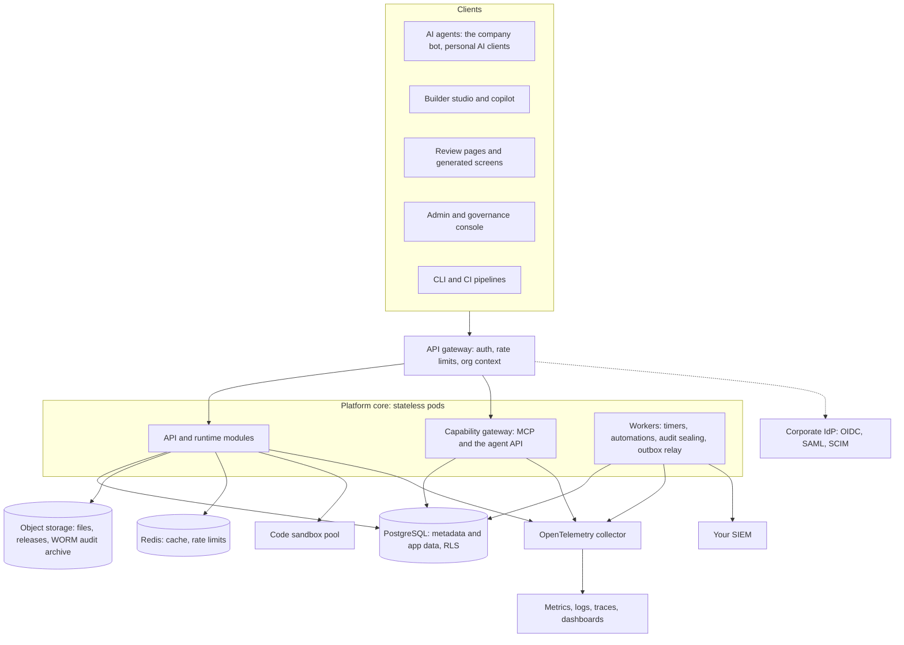

# Ambit: a governed capability platform for people and AI agents

> **Status:** draft v0.2 for discussion · 2026-11-15. Version 0.2 reframes the platform around capabilities that people and AI agents use (§6).
> **Companion:** [01-joget-review.md](01-joget-review.md), which covers what we learned from Joget DX 9.1 and why this design differs.
> **Ambition:** surpass Joget DX and be fit for enterprise use, rather than clone it.
> **Name:** **Ambit** (a3t), decided 2026-11-15: the bounds within which people and their agents act. It sits beside the owner's other apps, autonomic (a7c) and agentos (a5s). In product language, the things Ambit lets people get done are *errands*: "autonomic runs your errands, within your ambit". The rest of this document calls it "the platform".

## TL;DR

- **Decided:**
  - 2026-11-14: one company; cloud-agnostic and IdP-agnostic; TypeScript; ISO 27001:2022; no data-residency constraint.
  - 2026-11-15: people ask for outcomes and builders publish capabilities; the agent is a separate project; the first processes keep their data on the platform; it stays a low-code platform like Joget and Mendix, with visual designers next to an AI copilot.
  - 2026-11-16: an action's logic stays a short list of steps over Ambit's own data; automation across other systems belongs to a7c's skills, which an action can call. So there is one automation canvas, in a7c, not two.
  - 2026-11-17: a7c is left out for now. Ambit keeps its side of the link to a7c, switched off: until an installation connects a7c (`A7C_URL`), a definition whose actions start a7c skills is refused, and the templates and the example start none.
  - 2026-11-17: business processes are BPMN 2.0. Ambit imports and exports BPMN 2.0 XML, runs a stated part of BPMN 2.0 on its own engine in PostgreSQL rather than Temporal, and grows that part. A business process, where people decide on an app's records, is Ambit's; automation, where machines do work across systems, is a7c's (§6.10).

  Production is separated from everything else (§7.3), and §15 maps the design to ISO 27001 controls.
- **People ask for outcomes; builders publish capabilities.** For the person doing the work, the app disappears: they ask an agent for an outcome, in Teams, Slack, Matrix, Signal or the web, then check a review card and confirm. For builders and governance, the app remains as the package that capabilities ship in: owned, versioned, reviewed, released and audited (§6).
- **A low-code platform, like Joget and Mendix.** Builders design data, forms, pages and logic visually in the studio. An AI copilot and code (YAML in Git) edit the same definitions. The screens they design, and the tools agents call, are two ways to use the same app (§6.5).
- **A capability is a contract the platform enforces.**
  - Actions change something; queries answer something.
  - Each has typed inputs, rules checked on the server, an effect, a confirmation level, a review card and a list of who may use it.
  - Each is published automatically as an MCP tool and an OpenAPI operation (§6.2).
- **Agents propose, people approve.** The platform enforces confirmation; the agent framework doesn't.
  - An agent's call becomes a proposal, sealed with a hash.
  - The person approves that exact proposal from a verified identity, and the platform commits it.
  - An agent always acts for a named person, with that person's permissions narrowed to the agent's own (§6.3, §6.4).
- **Data is reached through connectors, as in n8n.** The platform's own governed store is the first connector, and other systems plug in the same way. Record- and field-level permissions, history and atomic commits hold in full in the built-in store. For other systems, the platform governs the call (§6.1).
- **AI builds too, under the same rules.** The builder API is also an MCP server, so Claude or the studio's own copilot can draft capabilities with the builder's permissions. In the builder's personal space, drafts apply live, except changes that would lose data. In a team space, a draft can only become a change request (§6.5).
- **Surpass, don't clone.** Match what Joget lets builders deliver, and beat it on governance, isolation, delivery, observability, audit and readiness for agents. Build security in rather than selling it as an extra (§1).
- **Modern, proven stack.** TypeScript end to end: a Fastify modular monolith, and React for the studio and the generated review screens. PostgreSQL, which also holds the state of Ambit's BPMN 2.0 engine, MCP for agents, OpenTelemetry and Kubernetes (§12).
- **Build the governance kernel first:** organizations, spaces, identity, one authorization engine and an audit pipeline. Joget attaches permissions to each component, and retrofitting them is the most expensive change a low-code platform can face.
- **Build in personal, run in team.** Every user gets a private **personal space**, which is their development environment, both for their own apps and for working copies of team apps. **Team spaces** run approved apps in **Prod**. Each change request gets a temporary **preview** for review and testing, and a persistent **Staging** environment is optional. Changes reach a team space only through an audited change request.
- **Permissions are permission sets bound at a scope.** Atomic permissions are grouped into reusable **permission sets**. Permission sets are composed into **roles**. Both are granted through **bindings**, which record who gets what, where, and until when. Org-level **guardrails** never grant: they deny, demand fresh MFA, or hold an action for the person's confirmation. One policy decision point (PDP) answers every request, whether it comes from the API, the UI, an agent, the workflow engine or custom code.
- **Deploying means flipping a pointer.** Each app change becomes an immutable, hashed **release**. Deploying it applies a reviewed migration plan and switches the environment's active version. That takes seconds, needs no restart, and rolls back instantly. The platform itself runs as stateless containers.
- **Observable and auditable by construction.** Every request carries OpenTelemetry org, space, app and env attributes. Every state change writes an audit event in the same database transaction, including what each agent did and for whom. The events are sealed in signed hash batches on WORM storage.

---

## 1. Goals, positioning, principles

### Goals

| # | Requirement | Definition of done |
|---|---|---|
| G1 | Multi-user | Thousands of users and hundreds of teams build and use apps at the same time; every object is isolated by organization and space |
| G2 | Roles | Predefined, customizable roles at org, space and app level, with a clear split between *building*, *operating*, *using* and *auditing* |
| G3 | Personal space | Every user automatically gets a private space to build and try things in, with limits that stop it becoming shadow production |
| G4 | Team space | Shared spaces with membership, roles, environments and change control |
| G5 | Permission sets | Reusable, named, versioned permission bundles that can be assigned, with expiry, to users, groups and service accounts |
| G6 | Well governed | Preventive guardrails, separation of duties, an owner for every app, access reviews, data classification, quotas |
| G7 | Deploy efficiently | App deploys in seconds without restarts, promotion across environments, instant rollback, a CI/CD API, zero-downtime platform upgrades |
| G8 | Monitoring | Platform SLOs; health, workflow and automation monitoring for each space and app; alerting; usage metering |
| G9 | Auditable | Every security-relevant action records who, what, when, where, why, and before/after. The log is tamper-evident, searchable and exportable, and can stream to a SIEM |
| G10 | Enterprise-grade | Meets the readiness targets below for availability, disaster recovery, security, compliance, accessibility and operations |
| G11 | Surpass Joget | Matches what Joget lets builders deliver (the parity list below) and beats it on every row of the comparison below |
| G12 | Agent-ready | Every capability can be used by AI agents through MCP and the API, always acting for a named person. The platform enforces confirmation and keeps a full record of what agents did and for whom |
| G13 | AI-assisted building | Builders work with an AI copilot. AI clients such as Claude can build through an MCP server with the builder's permissions, and everything they produce passes the same checks and reviews |

### Where this surpasses Joget

The left column summarizes the [review](01-joget-review.md) of Joget DX 9.1: the Community Edition, with Enterprise features noted where Joget's own pages list them.

| Area | Joget DX 9.1 | This platform |
|---|---|---|
| Workspaces | None: every app is global to the instance | Personal and team spaces as first-class scopes (§3) |
| Roles | 4 fixed roles. Per-app delegation works by temporary admin elevation | Custom, scoped roles built from permission sets, with SoD, JIT elevation and access reviews (§5) |
| App permissions | Inline rules on each menu, form and list. The API uses a different model | One model for the UI, API, workflow and code, with record- and field-level rules and permission diffs in review (§5.5) |
| Data isolation | Global `app_fd_*` tables shared by all apps. Every column is text | Typed schemas per app and environment, declared cross-app references, classification tags (§6.8) |
| Custom code | BeanShell inside the server JVM | A capability-limited sandbox, out of process (§10) |
| Change control | Publishing flips a flag and the live version is editable. No locks, review or rollback | Working copies in personal spaces → change requests with a live preview → checks → approvals → immutable releases (§6) |
| Schema changes | Additive DDL at runtime | Generated, reviewed, expand/contract migrations, with free renames (§6.8) |
| Delivery | `.jwa` import through the console. No CLI or import API | API and CLI, signed bundles, GitOps, promotion across installations (§7.1) |
| Topology | Single WAR with a local data directory. Clustering is Enterprise-only | Stateless pods on managed Kubernetes with autoscaling, built in (§7.2) |
| Monitoring | Log viewer. APM is Enterprise-only. No metrics endpoints | OpenTelemetry built in: SLOs, per-app dashboards, workflow SLAs, alerts, metering (§8) |
| Audit | Method-level trail with no outcomes, diffs, tamper evidence or retention | Structured events written in the same transaction, sealed, retained and streamed to a SIEM, plus record history (§9) |
| Identity | Unsalted MD5 hashes in the built-in directory. LDAP, MFA and password policies are Enterprise-only | Federation first (OIDC, SAML, SCIM), MFA and passkeys, and scoped tokens, built in (§4) |
| Isolation | Inside an instance, every app shares the same tables. Tenants need a database per profile, and CE's single connection pool isn't built for concurrent tenants | A database role and schema for each app, and production separated from non-production at the network, database and account level (§6.8, §7.3) |
| Validation | Form validators | Rules that the server runs for every write: form, API, agent or automation (§6.2) |
| AI | Joget Intelligence (DX 9): AI features inside the builder and in apps | Every capability is a tool for any agent. An agent acts for a named person, and the platform enforces confirmation (§6.2–§6.4). AI copilots build through the same API and reviews as people (§6.5) |

### Parity: what Joget already does that we must also do

Surpassing Joget on governance is worthless if builders can't deliver what they rely on Joget for. These are table stakes:

| Capability | Phase (§13) |
|---|---|
| Visual designers in the studio: the data model, and drag-and-drop forms with conditional visibility and multi-page layouts | 1 |
| Visual designers for pages, navigation and dashboards, and for logic flows: what an action does, step by step, like Mendix microflows or an n8n workflow | 2 |
| Rich data: typed fields, lookups and relations, line items (child records), file and image upload, calculated fields, validation rules | 1 |
| Screens: generated from entities and actions as a starting point, refined in the designers. Review cards and review pages for confirming what agents prepare | 1–2 |
| Lists with filters, sorting and bulk actions, and export (CSV, Excel, PDF) governed by `record.export` | 1–2 |
| Dashboards, themes and branding, with a responsive UI | 2–3 |
| Internationalization: UI translations, right-to-left layouts, per-app message bundles, time zones | 2 |
| App templates, import and export | 2 |
| A permissioned API for each app: every capability is an OpenAPI operation and an MCP tool (Joget's API Builder is Enterprise-only) | 1 |
| Business processes in BPMN 2.0, with human tasks, org-chart routing (requester, head of department, reporting line, department, group, role), parallel branches, timers and SLA escalation, and BPMN 2.0 import and export | 3 |
| A universal task inbox across apps, with delegation, out-of-office cover and reassignment | 3 |
| Notifications by email, Teams and Slack, with deep links | 3 |
| Connectors: REST, SOAP, databases (including Oracle and SQL Server), webhooks in and out, inbound email, scheduled jobs | 3–4 |
| Document generation (PDF from templates) | 3 |
| An installable PWA with offline drafts | 5 |
| A marketplace of signed templates and plugins | 5 |

The designers are the core of a low-code platform, as in Joget and Mendix, and they edit the same definitions as the AI copilot and the builder MCP. A builder can start from a description, from generated screens, or from a blank canvas, and switch between them freely.

### Enterprise readiness targets

These are initial targets, to validate with load tests and pilot teams:

| Area | Target |
|---|---|
| Availability | 99.9% monthly for the app runtime (99.95% with multi-zone deployment). No single point of failure. Zero-downtime upgrades |
| Disaster recovery | RPO ≤ 5 minutes (continuous WAL archiving), RTO ≤ 1 hour. Cross-region backups, with restore drills every quarter |
| Scale (design target) | 50,000 users, 5,000 concurrent sessions, 2,000 apps and 100 million records, with headroom to scale out |
| Performance | Runtime API p95 under 300 ms for single-record reads and writes. Deploy and rollback in under 30 seconds |
| Security | OWASP ASVS Level 2, and Level 3 for authentication and access control. TLS 1.2+ and encryption at rest. Encryption keys held in the cloud KMS under your security team's control, and field-level encryption for `Restricted` data. Signed images and SBOMs, an annual penetration test, and patch SLAs for critical vulnerabilities |
| Compliance | ISO 27001:2022 (decided). The platform implements and evidences the Annex A controls mapped in §15: the audit log, access reviews, change records and environment separation. Tooling for data-subject export and erasure. Retention policies and legal holds |
| Accessibility | WCAG 2.2 AA for the builders and for generated apps |
| Operations | Runs on any conformant Kubernetes and any PostgreSQL, managed or self-hosted, defined as infrastructure as code (OpenTofu) and deployed by GitOps. Workload identity instead of static cloud keys. Runbooks and support bundles |
| Compatibility | App definitions carry a schema version and are upgraded automatically. Releases stay deployable for at least one platform major version. A documented deprecation policy |

### Non-goals for the MVP (phases 0–2)

Marketplace, native mobile apps, real-time co-editing, and a BI/reporting suite. Several of these arrive in later phases (§13), but none of them should shape the kernel.

The agent itself is out of scope for the platform: its conversations, model orchestration and chat adapters are a separate project that uses the platform (§6.4).

### Principles

1. **Kernel first.** Identity, scopes, authorization and audit exist before any builder does. Builders, apps and agents are clients of the kernel.
2. **One authorization path.** No component has its own permission logic. The UI hides what the PDP denies, but only the PDP enforces access.
3. **Everything is scoped.** Every row and object carries `org_id` and `space_id`. Tables, apps, files and plugins have no global namespace.
4. **Definitions are data, releases are immutable, and a deploy is a pointer flip.**
5. **No change without an audit event.** The event is written in the same transaction as the change.
6. **Stateless runtime.** There is no shared filesystem and no sticky sessions. All state lives in Postgres, object storage and Redis.
7. **Custom code is sandboxed and permissioned.** It runs as a principal, never in-process with platform privileges.
8. **Secure by default.** Private by default, deny by default, least privilege, and secrets by reference only.
9. **Language for intent, UI for verification.** People state the outcome they want. Before anything that matters is committed, the platform shows exactly what will happen, as a structured card rather than a paragraph of text.
10. **Agents propose, people approve.** An agent acts for a named person and never beyond that person's permissions. It can prepare work, but it can never approve its own proposal.
11. **Rules run on the server.** Every write path runs the same rules: form, API, agent or automation. A form is a convenience, never the place where checking happens.

---

## 2. Core concepts



| Concept | Meaning |
|---|---|
| **Organization** | The top-level boundary (your company), holding users, groups, spaces, policies, the audit log and quotas. A one-company install has exactly one org, but the key exists from day one so that a subsidiary can be added later. |
| **User / group / service account** | The principals. Users and groups usually come from the corporate IdP through SCIM. Service accounts are non-human, are owned by a space, and serve integrations, CI and agents. |
| **Space** | A container that owns apps, connections, service accounts and environments. It is either `personal` (exactly one per user) or `team`. |
| **App** | The package that capabilities ship in, together with their data model, rules, review cards, roles and, optionally, forms and pages. It belongs to exactly one space, has a named owner, and is versioned, reviewed and released as a unit. People rarely open an app: they use its capabilities, through an agent or a generated screen. |
| **Capability** | Something people and agents can get done with an app: an **action** that changes something (submit a claim) or a **query** that answers something (my open claims). It has typed inputs, server-side rules, an effect, a confirmation level, a review card and permissions. Each is published as an MCP tool and an OpenAPI operation (§6.2). |
| **Rule** | A check the server runs on every write, whatever the path. An error blocks the write. A warning travels with the record to whoever approves it. |
| **Review card** | The structured summary a person checks before confirming an action. The app's owner designs it, and the platform fills it from the exact data the action will write. |
| **Proposal** | An action an agent has prepared but not committed. It holds the exact change, the rule findings and where each value came from, sealed with a digest. The person it was made for approves, edits or rejects it (§6.3). |
| **Agent** | Software that acts for people, such as the company's Teams bot or a person's own AI client. Agents are registered as service accounts and always act for a named person (§6.4). |
| **Connector / connection** | A connector knows how to talk to one kind of system: the platform's built-in store, a REST API, a database, email. A connection is one configured instance of a connector, with its credentials held as secrets. Capabilities reach all data through connections (§6.1). |
| **Working copy / change request** | A working copy is a builder's editable copy of a team app, kept in their personal space. A change request asks to merge it into the team app, and carries its diff, checks, preview and approvals. |
| **Release** | An immutable, content-hashed, signed snapshot of an app's definitions, plus a manifest of its dependencies. |
| **Environment** | An isolated runtime namespace: a personal space's **Sandbox**, a team space's **Prod**, an optional **Staging**, or a temporary **Preview** for a change request. Each has its own data schema, config values, secrets, connection bindings and role-to-group mappings. |
| **Deployment** | The record of putting a release into an environment: plan, approvals, executor, result and health. |
| **Permission / permission set / role / binding** | See §5. |
| **Guardrail** | An org-level policy that can deny an action, or require something such as approvals, regardless of grants. |
| **Audit event** | An append-only record of an action. See §9. |

---

## 3. Spaces

| | Personal space | Team space |
|---|---|---|
| Created | Automatically at first login | By users holding `space.create`, or on request |
| Visible to | Only the owner. Individual apps can be shared with up to *N* named users | Members, according to their space role. App users, according to app roles |
| Environments | One **Sandbox** in the non-production plane (§7.3), where edits apply immediately. This is where all building happens | **Prod** in the production plane, plus a temporary **Preview** for each open change request. A persistent **Staging** environment is optional |
| Change control | None: the owner edits live | Change requests from builders' working copies, reviewed in their preview, then approved and released |
| Data connections | Sample data and connections tagged `personal-allowed`. A guardrail blocks production connections | Bound per environment |
| Public/anonymous access | Never | Only with Security admin approval (a guardrail) |
| Custom code | Off by default | For holders of `code.author`, reviewed in change requests |
| AI agents | Your own AI clients, such as Claude, act for you only. Colleagues you share an app with can use its capabilities through their own agents | Registered agents, such as the company's Teams bot, act for the app's users. A Security admin approves each agent and caps what it may do (§6.4) |
| Quotas | Small fixed caps on apps, records, storage and automation runs | Set for each space by org admins |
| When the owner leaves | The space is frozen. Its apps go to the manager, or are archived after a retention period | No effect: a team space must always have at least 2 owners |

### Working copies: building team apps in your personal space

Team spaces have no permanent Dev environment, because each builder's personal space already plays that role.

1. A builder who holds `app.edit` on a team app chooses **Edit in my space**. The platform creates a linked **working copy** in their personal space, with sample or synthetic data and only non-production connections.
2. They build and try the change in their Sandbox, without ceremony, exactly as they would with a personal app. An AI copilot can do the drafting (§6.5), and they can try the result by asking their own agent to use it.
3. **Submit change** opens a change request in the team space. The request carries the diff, the automated checks (§6.7) and a **Preview**: a temporary environment in the non-production plane, built from the change, that reviewers and business testers can click through.
4. On approval, the change is merged and released, and the release is deployed to Prod (§7.1). The preview is deleted, and the working copy is either reset to the new main line or archived.

Several builders can work on the same app at once, each in their own working copy. Conflicts are detected when changes are merged (§6.7). Teams that test against other systems' test instances, such as an ERP sandbox, can enable a persistent **Staging** environment between the release and Prod.

**As built (phase 2):**

- A team app starts empty. Its content arrives through change requests, so nothing reaches Prod unreviewed, the first version included.
- A working copy keeps the main line's stable IDs, so its changes map cleanly onto Prod's tables. It starts with three sample records for each entity, made through the app's own rules.
- The working copy stays after a merge, and continues from the merged revision. A builder whose copy is older selects **Take in newer changes**: a three-way merge, as in §6.7.
- A preview is an environment of the team app. Builders, reviewers and release managers may do anything in a preview, and nothing with Prod's data, through the managed permission set *Try changes in previews*. That set applies only where the resource's environment is a preview. Business testers get one of the app's roles in Staging from a space admin.
- Staging and Prod are made by the first deployment to them.

### Promotion: personal → team

1. The owner chooses **Promote** and picks a target team space where they hold `change.open`.
2. The platform opens a **change request** in the target space that contains a copy of the app, with a new app ID and a lineage link to the source.
3. The target space's reviewers approve it, after the same checks as any other change: guardrails, permission diff and data classification.
4. On merge, the personal copy becomes read-only (or is archived), and its sharing links redirect to the new app.
5. Data is not copied unless that is explicitly requested, approved and classified.

Why: personal spaces stay fast and free of ceremony. Anything that outgrows "me plus a few colleagues" moves to a place with owners, environments and change control. A guardrail can also *nudge* the owner, for example: "this personal app has 12 users, consider promoting it".

**As built (phase 2):**

- **Move to a team space** makes an empty team app in the target space that names the personal app as its source, and a working copy of it in the owner's personal space that starts from the personal app's definition. The change request from that copy is the promotion. Its checks show everything the app brings: entities, rules, actions and the a7c skills they start, roles, pages and the menu.
- The owner needs `app.create` and `change.open` in the target space. One promotion of an app runs at a time.
- The personal app keeps working until the team app first runs in Prod, so its people are never without a working app. Then a managed guardrail makes it read-only: its people keep reading what they did there, and it points to the team app.
- Data stays in the personal app. Copying it waits for a request that is approved and classified.


### Space lifecycle

`active → frozen (read-only) → archived → deleted (after retention)`. Every transition is audited, and deletion honours legal holds.

---

## 4. Identity

- **IdP-agnostic, federation first.** The platform is a standard OIDC relying party, so it works with any IdP that speaks OIDC: Entra ID, Okta, Google, Keycloak, Ping and others. SAML-only IdPs connect through an optional broker (Keycloak). The platform never calls an IdP's proprietary API and does not store corporate passwords. Group claims and MFA evidence (the `acr` and `amr` claims) are mapped by configuration, not code.
- **SCIM 2.0** provisions users and groups. Deprovisioning revokes sessions and tokens immediately and freezes the user's personal space.
- **Local accounts** exist only for small installs and break-glass access, with a password policy, MFA (TOTP or WebAuthn/passkeys) and lockout.
- **Groups** are either synced from the IdP (read-only on the platform) or managed on the platform and owned by a space.
- **The directory** is what apps need of it, and no more. By ID, it names the people and agents that records and history mention, including people who have left. By part of a name or email, it finds active colleagues, at most ten at a time, for a person field. People, and agents acting for them, may look; a service account acting as itself may not.
- **Service accounts** are owned by a space and have no interactive login. They get short-lived tokens through client credentials or workload identity federation.
- **Agents** are service accounts with an agent profile.
  - A team space owns each agent. A Security admin approves it to act for people, and sets the most it may do (its scopes).
  - The agent acts for a person through OAuth 2.0 Token Exchange (RFC 8693). It presents proof of the person's identity, for example their Teams single sign-on token checked against the corporate IdP, and gets a short-lived platform token.
  - Effective permissions are the person's grants, narrowed to the agent's scopes. The audit log records both the agent and the person.
  - An agent's scopes are capped at errands: `app.run`, `action.run`, `query.run` and `record.read`. A token's scopes decide which operations it may enter; inside an action or a query, the person's own record permissions apply. So an agent can submit a claim through its action, but never write records directly or change anyone's access.
  - The token lives 10 minutes, and dies at once if the agent's approval is revoked. Exchanging never changes who the person is or which groups they're in.
  - The person is identified by a configurable claim. Entra ID makes `sub` different for each application, so there Ambit uses `oid`, which is the same in every app of the tenant.
  - Chat platforms that carry no corporate identity, such as Signal, need a one-time account link.
  - A person's own AI client, such as Claude, connects to the platform's MCP endpoints through MCP's standard OAuth sign-in, or with a personal access token.
- **Personal access tokens** carry a scoped subset of the user's own permissions and have a maximum TTL (for example 90 days). Admins can see and revoke them. Effective permissions are the intersection of the user's permissions and the token's scopes. Tokens can only be created from an interactive session with fresh MFA, so a leaked token cannot mint more tokens, and a token never satisfies a fresh-MFA guardrail.
- **Sessions** use short-lived access tokens, rotating refresh tokens, idle and absolute timeouts, and server-side revocation.
- **Step-up MFA** is required for sensitive actions: deploying to Prod, changing bindings or guardrails, exporting data, and break-glass. The platform asks the IdP for a fresh MFA login through standard OIDC parameters (`max_age`, `acr_values`), so this works with any IdP.
- **Impersonation** ("view as") is for support only. It is time-boxed, needs a justification, is visible to the impersonated user, is audited with `on_behalf_of`, and is read-only by default. The audit log uses the same `on_behalf_of` field for the person an agent acts for.

---

## 5. Authorization: roles, permission sets, bindings

### 5.1 Building blocks

| Concept | What it is | Example |
|---|---|---|
| **Permission** | An atomic verb on a resource type | `app.edit`, `deploy.approve`, `record.export` |
| **Permission set** | A reusable, named, versioned bundle of permissions, optionally with conditions. It can only add permissions | "Release management" = `release.create`, `deploy.request`, `deploy.read` |
| **Role** | A job function made of one or more permission sets, intended for one scope type | "Release manager" (space scope) = Release management + App read |
| **Binding** | Grants a role *or* a permission set to a principal at a scope, with an optional expiry, justification and approver | Alice → Release manager @ space *Finance*, until 2027-03-31 |
| **Guardrail** | An org-level rule that denies or requires something, overriding grants | "Prod deploys need 2 approvals and a passing check run" |

Admins assign roles day to day. Permission sets are the building blocks, and can also be granted directly for exceptions such as "Bob may export Expense records until Friday". This mirrors the role-plus-permission-set model that large SaaS platforms have converged on, and the Role/RoleBinding split in Kubernetes.

### 5.2 Scope hierarchy

```text
org ──▶ space ──▶ app ──▶ environment
```

A binding applies to its scope and everything below it. **Exception:** personal spaces do not inherit org-level roles, apart from the administrative permissions `space.freeze` and `space.transfer`. For an admin to read personal-space content takes break-glass access, which is time-boxed, justified, notified and audited.

### 5.3 Platform permission catalog (excerpt)

| Resource | Permissions |
|---|---|
| Org | `org.settings.manage`, `org.guardrail.manage`, `org.audit.read`, `org.audit.export` |
| Directory | `directory.user.manage`, `directory.group.manage`, `directory.service_account.manage` |
| Access | `access.binding.manage`, `access.permission_set.manage`, `access.review.run`, `access.breakglass.activate`, `access.agent.approve` (let an agent act for people, and cap its scopes) |
| Space | `space.create`, `space.read`, `space.settings.manage`, `space.member.manage`, `space.freeze`, `space.transfer`, `space.delete` |
| App definition | `app.create`, `app.read`, `app.edit`, `app.share`, `app.export`, `app.delete` |
| Change | `change.open`, `change.review`, `change.approve`, `change.merge` |
| Release / deploy | `release.create`, `deploy.request`, `deploy.approve`, `deploy.execute`, `deploy.rollback` |
| Environment | `env.config.manage`, `env.secret.write` (write-only: secret values are never readable), `env.binding.manage` |
| Connection | `connection.use`, `connection.manage` |
| Extensibility | `code.author`, `plugin.install`, `plugin.approve` |
| Operations | `ops.monitor.read`, `ops.job.retry`, `ops.task.reassign` |
| Capabilities (per action or query) | `action.run`, `query.run` |
| Runtime data (per entity) | `record.read`, `record.create`, `record.update`, `record.delete`, `record.export` |
| Workflow (per process) | `process.start`, `task.claim`, `task.complete`, `task.reassign`, `process.admin` |

### 5.4 Default roles (managed by the platform; orgs can clone and customize them)

| Scope | Role | Gist |
|---|---|---|
| Org | **Org owner** | Everything at org scope. At least 2 required |
| Org | **Org admin** | Users, groups, spaces, settings. **No access to runtime data by default** |
| Org | **Security admin** | Guardrails, permission sets, access reviews, approving break-glass |
| Org | **Auditor** | Read-only access to the audit log, configuration and bindings. Cannot be combined with any admin role |
| Org | **Platform operator** | Monitoring, platform health, job retries. No app data |
| Space | **Space owner** | Everything in the space. At least 2 required in a team space |
| Space | **Space admin** | Members, settings, environment config, role-to-group mappings |
| Space | **Builder** | Creates working copies of the space's apps in their personal space, and opens change requests |
| Space | **Reviewer** | Reviews and approves change requests |
| Space | **Release manager** | Cuts releases, requests and executes deployments (Prod still needs approval) |
| Space | **Operator** | Monitors apps, retries automations and reassigns tasks in its environments |
| Space | **Viewer** | Reads app definitions and monitoring |
| App | *(defined by builders)* | For example Requester, Approver, App admin. See §5.5 |

**Space roles govern building and operating; app roles govern using.** People who only use an app never need to be space members.

### 5.5 Permissions inside apps

Builders define **app roles as permission sets over the app's own entities and processes**:

- **Entity level:** `record.read|create|update|delete|export` for each entity.
- **Capability level:** who may run each action and query (`action.run`, `query.run`). A capability then runs under the caller's record- and field-level permissions, so an agent never sees or changes more than the person it acts for could.
- **Record level:** conditions such as *owner is me*, *assigned to me*, *same department as me*, or a predicate on a field. Conditions are written in a safe expression language (a CEL subset) and stored as structured JSON. The policy engine fills in what it knows about the person and turns the rest into a SQL filter (partial evaluation).
- **Field level:** each field can be hidden, read-only or masked per role. Fields tagged `PII` are masked unless a role explicitly unmasks them.
- **Lines share their record's permissions.** Line items, such as one line per receipt on a claim, are part of their record: whoever may read or change the record's lines field may read or change its lines, and roles name the fields of lines as `lines.amount`. Adding, removing or reordering lines needs every field of a line; changing lines needs just the fields that change.
- **Process level:** who may start a process, which role each human task is assigned to, and who may reassign tasks.
- **The UI follows the data.** Pages, menus and buttons are shown according to the same permission sets, so there is no separate "menu permission" to forget. If a role cannot `record.read` an entity, its page is hidden **and** its API is denied.

App roles are bound to groups **per environment**, for example *QA testers* in previews and Staging, and *Finance approvers* in Prod. These mappings belong to the environment, only Space admins can change them, and every change is audited.

```yaml
# roles/approver.yaml: an example app role
name: Approver
entities:
  expense_claim:
    read:   { where: "record.status in ['submitted', 'approved'] && record.department == principal.department" }
    update: { where: "record.status == 'submitted'", fields: [status, approver_comment] }
    export: false
  employee:
    read:   { fields: { exclude: [bank_account] } }
processes:
  expense_approval:
    tasks: [approve_claim]
```

### 5.6 Guardrails (org level)

Guardrails are rules that deny an action or require something before it. They are evaluated at design time (in the builder), at merge time (on change requests) and at run time. A guardrail can deny, require fresh MFA, or **require confirmation**: the action then waits as a proposal until the person confirms it (§6.3). Examples:

- Agents need a person's confirmation for any action that spends money or sends something outside the company.
- An action on PII through an agent needs a full review.
- Pages with anonymous access cannot reach Prod without Security admin approval.
- Fields tagged `PII` must be masked in views and are excluded from exports by default.
- Personal spaces cannot bind connections tagged `production`.
- A change that contains custom code needs a reviewer from the *Platform engineering* group.
- A Prod deployment needs 2 approvals and a green check run, and can optionally be limited to a change window.
- Records of entities tagged `retention:7y` cannot be hard-deleted.

### 5.7 Separation of duties, just-in-time access, reviews

- **Separation-of-duties (SoD) constraints** are checked when a binding is created, for conflicting roles such as Auditor plus Org admin. They are checked again when an action runs: the author of a change can neither approve it nor approve its Prod deployment.
- **Just-in-time elevation:** a sensitive role such as Prod operator can be *eligible* rather than active. Activating it takes a justification (and optionally an approval), lasts a few hours at most, and is audited.
- **Access reviews:** scheduled campaigns ask space owners to re-certify their members and bindings, and anything not confirmed expires automatically. Bindings unused for 90 days are flagged.
- **Expiry everywhere:** bindings, tokens and shares can all carry `expires_at`, and temporary grants are the default for exceptions.

### 5.8 Decision algorithm and enforcement points

```text
authorize(principal, action, resource, context) -> Decision{allow|deny, reasons[]}
  1. principal  := user + transitive groups (or a service account), intersected with token scopes;
                   for an agent acting for a person: the person's grants, narrowed to the agent's scopes
  2. chain      := scope chain of the resource: env → app → space → org (personal spaces stop at space)
  3. bindings   := the principal's active, unexpired bindings on any scope in the chain
  4. grants     := bindings → roles → permission sets → permissions (+ conditions)
  5. allow      := some grant matches the action and its condition holds (record, field, context);
                   record conditions are partially evaluated, and what remains becomes a row filter
  6. guardrails := org guardrails for the action; any deny or unmet requirement → deny, with a reason
  7. step-up    := a sensitive action with MFA older than N minutes → deny(reason = step_up_required)
  8. confirm    := an agent's action that needs confirmation (its level, or a guardrail) → a proposal (§6.3)
  9. audit      := always for sensitive actions and denials; sampled for routine allows
```

Every enforcement point calls the same PDP:

1. **API layer.** Every endpoint declares its `(action, resource)`. A test fails if any route lacks a declaration, so no endpoint can be left unprotected.
2. **Data layer.** List and search queries receive row filters and field masks generated by the PDP. As defence in depth, each app's schema has its own database role, and the runtime switches to that role inside each transaction (§6.8). A query-building bug therefore cannot cross app boundaries.
3. **Workflow engine.** Claiming, completing and reassigning tasks are authorized actions.
4. **Sandbox.** Custom code calls platform APIs with a token for the invoking principal (or the app's service account), never as a superuser.
5. **UI.** Hides what the PDP denies. This is for usability only and is not a security boundary.

Every decision is **explainable**, for example "allowed by binding B via permission set P" or "denied by guardrail G". That powers an admin tool that answers *"Why can, or can't, this user…?"*, and it feeds the audit trail.

### 5.9 Storage sketch

```sql
create table permission_set (
  id          uuid primary key,
  org_id      uuid not null,
  name        text not null,
  scope_type  text not null check (scope_type in ('org', 'space', 'app', 'env')),
  version     int  not null default 1,
  managed     boolean not null default false
);

create table permission_set_item (
  permission_set_id  uuid not null references permission_set,
  permission         text not null,                -- 'deploy.approve', 'record.read', ...
  resource_selector  text not null default '*',    -- e.g. an entity name inside an app
  condition          text,                         -- CEL expression, null = unconditional
  primary key (permission_set_id, permission, resource_selector)
);

create table role (
  id uuid primary key, org_id uuid not null,
  name text not null, scope_type text not null, managed boolean not null default false
);

create table role_permission_set (
  role_id            uuid not null references role,
  permission_set_id  uuid not null references permission_set,
  primary key (role_id, permission_set_id)
);

create table binding (
  id                 uuid primary key,
  org_id             uuid not null,
  principal_type     text not null check (principal_type in ('user', 'group', 'service_account')),
  principal_id       uuid not null,
  role_id            uuid references role,
  permission_set_id  uuid references permission_set,
  scope_type         text not null,
  scope_id           uuid not null,
  expires_at         timestamptz,
  justification      text,
  granted_by         uuid not null,
  approved_by        uuid,
  created_at         timestamptz not null default now(),
  check ((role_id is null) <> (permission_set_id is null))   -- exactly one of the two
);

-- org_id stays on every table, so a second org (for example a subsidiary) can be added later.
-- With one org, isolation is enforced by space and app: see §6.8.
```

With bindings stored relationally, governance questions are cheap to answer: *"Who can deploy to Finance Prod?"* is a query, not a code audit. Keep the PDP behind an interface, so that a Zanzibar-style engine (OpenFGA, SpiceDB) or Cedar can replace the evaluator later if sharing graphs get complex.

---

## 6. Apps, capabilities and governed change

People increasingly get work done by asking an AI agent rather than by operating an app. The app doesn't disappear; it splits:

- **The parts that existed to operate the system mostly go away:** menus, navigation, typing values into fields.
- **The parts that let a person check and commit work stay, and they matter more,** because people now approve work they didn't do themselves.

The rule of thumb is **language for intent, UI for verification**. So the platform separates two views of the same thing:

- **People ask for outcomes.** For example: "Claim last week's Singapore trip." An agent picks the capabilities that get it done, prepares the work and shows a review card. The person checks it and confirms.
- **Builders publish capabilities, and apps package them.** The app is what's owned, versioned, reviewed, released and audited: its capabilities, their data, rules and review cards, and its roles.

Not everything is a task. Exploring data, comparing options and monitoring a process still need screens that stay put, so the platform remains a full low-code platform: builders design pages, forms, lists and dashboards in the studio, like Joget and Mendix. The task model fits transactional work best: claims, leave, bookings, purchase requests.

### 6.1 What an app is made of

| Artifact | What it is | Joget equivalent |
|---|---|---|
| Entity | A data model: typed fields, relations, line items (child records), files, classification tags (`PII`, `Confidential`) | A form and its `app_fd_*` table |
| Rule | A check the server runs for every write, whatever the path: form, API, agent or automation. An error blocks the write. A warning travels with the record to the approver | Form validators |
| Action | A business operation that changes something: create or update records, or start a process. It has typed inputs, a confirmation level and a review card. Its effect starts simple (set these values) and grows into a short list of steps over the app's own data: set values, add lines, check, branch. Work across other systems is an a7c skill that a step calls | Form submission and process start |
| Query | A named, parameterized read, such as "my open claims" or "status of a claim" | Datalist |
| Prediction | A value or flag a model computes, such as the likely category of a receipt, how unusual a claim is, or a forecast on a dashboard. Like any value, it records its source: the model and its version | None |
| Review card | What a person checks before confirming an action. The app's owner designs it, and the platform fills it from the exact data the action will write | None |
| Process | A BPMN 2.0 process about one record of an entity: events, user and service tasks, gateways and timers, run by Ambit's own engine (§6.10) | Process (XPDL) |
| Automation | Work that machines do across systems, triggered by record events, schedules or webhooks. It belongs to a7c's skills, which an action's step or a process's service task starts (§6.10) | Process tools, plugins |
| Connection | A configured connector: the built-in store, a REST API, a database or email. Secrets are held by reference | Plugins, API connectors |
| App roles | Permission sets over the app's capabilities and entities (§5.5) | Userview and form permission plugins, participant mappings |
| Forms and pages | Designed in the studio's form and page designers, starting from generated defaults | Form, Userview |
| Settings and translations | Values set per environment, and message bundles | Environment variables, message bundles |

**Data is reached through connections.** As in n8n, every system a capability reads or writes is a connection, and capabilities don't care where the data lives. The platform ships a **built-in store** as the first connector, for two reasons. The first processes have no existing system of record (§14). And some guarantees only hold where the platform controls the data:

| | Built-in store | Another system |
|---|---|---|
| Who may run the capability, its confirmation, and an audit of the call | The platform | The platform |
| Which records and fields a person sees | The platform: record- and field-level rules (§5.5) | The other system, ideally with the person's own identity |
| Committing exactly what was approved | One database transaction, together with the audit event | A call that is safe to retry; the platform records the request and the response |
| History of every value, and where it came from | The platform (§9.4) | Whatever the other system keeps |

**Files are kept by the built-in store, not passed around.** A file, such as a receipt, is uploaded first and then named by its ID in a record or line:

- The platform reads what a file is from its content, never its name or claimed type, and takes only images and PDFs.
- A malware scanner (ClamAV's clamd) checks every upload before anyone can use it. If the scanner can't answer, the upload is refused; production refuses uploads when no scanner is set up.
- An upload belongs to the person it was made for, even when their agent made it. Until a record refers to it, only that person can open it. A record can only take its owner's uploads, and each upload belongs to one record.
- Once attached, a file can be downloaded by whoever can see the field that holds it in that record, and by nobody else. The file stays while the record or its history refers to it. Uploads nobody attaches expire.
- Content lives in the app environment's own schema by default, under its isolation, or in any S3-compatible store behind the same adapter. Azure Blob and Google Cloud Storage adapters come next.

Connections should use the person's delegated sign-in wherever the other system supports it, so that system applies its own permissions. (In n8n, a workflow calls each system with the credential stored on its node, so the system sees that credential rather than the person who triggered the workflow.) Where only a shared credential exists, the platform decides who may call what, and the audit log names the person behind each call.

### 6.2 Capabilities: actions, queries, rules and review cards

An action, a rule and a review card for expense claims:

```yaml
# actions/submit_claim.yaml
label: Submit an expense claim
description: >                      # what agents read when choosing a tool
  File an expense claim for the person you act for, with one line per receipt.
entity: expense_claim
operation: create
input: [trip, purpose, lines]       # what the caller provides; lines are child records
set: { status: submitted }          # what the action sets itself
confirm: review                     # none | preview | review; guardrails can raise it
card: claim_review
```

```yaml
# rules/hotel_cap.yaml
entity: expense_line
when:     "record.category == 'hotel'"
assert:   "record.amount_per_night <= 250"
severity: warning                   # error blocks; warning travels to the approver
message:  "Hotel is above the SGD 250 nightly cap"
```

```yaml
# cards/claim_review.yaml
entity: expense_claim
title: "{{trip}}: {{total}}"
show: [purpose, total]
table: { of: lines, columns: [date, merchant, category, amount] }
first: findings                     # rule findings and open questions before everything else
```

- **Every capability is a tool.** The platform publishes each action and query as an MCP tool and an OpenAPI operation. The input schema comes from the entity's fields, and the description is written for agents.
- **Capabilities run as the caller.** Running an action needs `action.run`, and running a query needs `query.run`. Either then runs under the caller's record- and field-level permissions, so an agent can never do more than the person it acts for.
- **Every path shares the same rules.** They run the same way for a form, the API, an agent or an automation. Agents can ask for a dry run, which returns the findings without changing anything. So the problems on a review card come from the rules, not from the model.
- **Confirmation matches the risk:**

  | Level | For | What happens |
  |---|---|---|
  | `none` | Reads, and changes that are easy to undo | It runs, and the agent reports back |
  | `preview` | Spending money or sending something out | The agent shows the card, and one tap confirms |
  | `review` | Anything out of policy, or impossible to undo | A full review, findings first |

  Guardrails can raise a level, never lower it. A routine capability can move down a level once it has earned trust, measured by how often its proposals are approved without edits (§13, phase 5). It works like `terraform plan` and `apply`: the agent prepares the plan, and the person applies it.
- **Every value records where it came from:**
  - read from a document, with the attachment and the place on it;
  - inferred by the agent;
  - entered or edited by the person;
  - computed by the platform, or predicted by a model (with the model's name and version).

  The review card shows the source, the approver sees it, and the record's history keeps it (§9.4). Without it, review turns into rubber-stamping.

**Queries that work out numbers (built in phase 2).** A query can answer with a number, or with a number for each group, instead of records: the measures, groups and time ranges of a dashboard (§6.5). So an agent can ask "how much did I spend on hotels this year?" through a published query, rather than fetching records and adding them up. The query runs under the caller's permissions, like any other: it counts only the records the person may read, and refuses a total over a field their role masks. Its MCP tool says what shape the answer has.

**Steps (built in phase 2).** An action can do more than set fixed values. Its steps run in order, after its input and its set values:

```yaml
# actions/approve_claim.yaml (its steps, where an installation connects a7c)
steps:
  - { type: check, assert: "record.owner != principal.id", message: "You can't approve your own claim" }
  - { type: set, field: approver, value: { ref: principal.id } }
  - type: if
    when: "record.total > 1000"
    then:
      - { type: skill, label: Ask finance to check a large claim, skill: finance/check-large-claim, input: { claim: { ref: record.id } } }
  - { type: skill, label: Pay the claim, skill: finance/pay-expense-claim, input: { claim: { ref: record.id }, amount: { ref: record.total }, account: { ref: record.iban } } }
```

- **Five kinds of step.** *Set* gives a field a value. *Add a line* adds a line to a lines field, and the totals follow at once, for the steps after it. *Check* stops the action with a message, or warns and lets it through. *If* takes one of two short lists of steps; branches go one level deep. *Skill* starts an a7c skill.
- **Values are small expressions in JSON:** a literal, a field of the record, the person, today, now, a sum, a product, a difference, a quotient, a rounding, or text joined from parts. A number is rounded to its field's decimal places. There are no loops and no calls, so the result depends only on the record, the person and the time.
- **Steps run when the change is worked out.** A preview, a dry run and a proposal all show what the steps did. A proposal seals their result, and its digest covers the skills it starts. Approving it writes exactly that, and doesn't run the steps again.
- **An action does no more than the person may.** Fields that steps set count as written by the person, so the role's field permissions apply to them. The rules run on the result.
- **Steps see the record's real values,** not masked ones: they are the app's own logic, and a change request shows each change to them, naming each a7c skill gained or lost. The review card names the skills a change starts, but never their input, which can hold values the person can't read.
- **Switched off for now (decided 2026-11-17).** Skill steps work only where an installation connects a7c, with `A7C_URL`. Until then a definition whose actions start a7c skills is refused when it is saved or imported, the step designer doesn't offer the step, and the templates and the example start none. The example above shows the steps as they would be with a7c.
- **Work in other systems belongs to a7c.** A skill step doesn't call a7c during the action. It writes the call to an outbox, in the change's own transaction, so a call exists exactly when its change commits. A dispatcher then starts each call in a7c through `runs.start`, with the call's ID as the idempotency key, so a retry never starts a second run. It tries again while a7c can't be reached, with a wait that doubles up to an hour, and stops when a7c refuses the call. Operators see each call and how it went, and can try a failed one again.
- **The environment picks a7c's tier.** A sandbox starts skills in a7c's personal tier, Staging and previews in its team tier, and only Prod in its production tier. Trying a change never starts production work.
- **The record shows what it started.** Whoever can read the record sees each skill its actions started, and whether it is waiting, started or failed.

### 6.3 Proposals: agents propose, people approve



- **The platform enforces confirmation, not the agent framework.** Agent frameworks have their own human-in-the-loop step, but a buggy agent could skip it, or one steered by instructions hidden in a receipt or an email. On the platform, an action that needs confirmation can't commit until the person approves.
- **An approval names the exact change.** The proposal stores the change the action would make, the rule findings and the provenance, sealed with a digest. The person approves that digest, and the platform commits exactly that change. The card is built from the stored proposal, never from the agent's summary of it.
- **Only the person can approve.** The approval must come from their own verified identity: their platform session, or a chat adapter that proves who pressed Approve. The agent can propose but never approve. It's the same separation-of-duties rule that stops authors approving their own change requests (§5.7).
- **Edits belong to the person.** Editing a value makes a new revision of the proposal, which is checked again and marked "edited by you", with the original kept. If an edit contradicts its source, for example an amount that no longer matches the credit card statement, the platform asks for a reason rather than blocking.
- **Nothing is lost.** Rejected and expired proposals stay in the audit log with their digests.

### 6.4 Agents and channels

- **The agent is a separate project, and any agent will do.** Conversations, model orchestration and chat adapters live outside the platform, and call it through MCP and the API. So the platform depends on no single chat app or model, and any agent can use the same capabilities: Copilot, Claude, or the owner's agentos (a5s), the first agent planned. Three kinds of caller reach it:
  - agents that serve many people, such as agentos or a Copilot Studio bot, register once and act for one named person at a time (§4);
  - a person's own AI client, such as Claude Desktop, connects with that person's own credentials;
  - automations, such as an autonomic workflow, act as their own service account.
- **What agentos needs, to call Ambit:** an MCP client in its gateway, with Ambit's tool schemas pinned by hash as it pins its own; the token exchange done in its core, for the person a run acts for (in a group chat, the person who asked); and Ambit's proposals treated as an outside governed process that Ambit decides, not held a second time, with Ambit's review host among its `record_links`.
- **Agents are identities.** Each agent is a registered service account that acts for a named person, with that person's permissions narrowed to the agent's own (§4). The audit log records the agent and the person on every call.
- **Cards are data.** The platform describes a review card in a neutral JSON format:
  - the fields, with their values and sources;
  - the findings and open questions;
  - the allowed responses.

  Each adapter draws it natively, for example as an Adaptive Card in Teams or with Block Kit in Slack, and the platform's own review page draws the full version. Standards for agent interfaces, such as MCP Apps and Google's A2UI, are still settling, and the card format should map onto them.
- **Some channels can't prove who clicked.** Where an adapter can't verify the person's identity strongly enough for an approval, it hands off to the review page, behind single sign-on.

### 6.5 Building: the studio, an AI copilot, or code

- **The studio is a visual low-code builder,** like Joget and Mendix. It has designers for the data model, forms, rules, actions, queries, review cards and roles, then pages, navigation and dashboards, and steps for actions. Builders work in their personal space, where every change applies at once to their sandbox.
  - The first slice ships in phase 1. The data designer edits entities and fields, reorders them by dragging, and renames without touching data. Saving shows the migration plan first, and anything that deletes data needs a second confirmation. The form designer lays fields out in sections, at full or half width, with labels and help, and picks the action a form submits through, so its rules and confirmation apply. Rules, actions, queries, review cards and roles have designers too, from phase 2's first step: conditions are built as clauses (a field, a test, a value; all or any of them), and roles as a matrix of who may do what with which records. The whole definition can still be edited as JSON, and is checked like any other change when it's saved.
  - Every app gets its screens without design work: lists, forms and record pages, generated from what each person may do, so a colleague in a narrow role sees only what that role allows. Pages and dashboards designed in phase 2 replace these defaults where a builder wants something else.
  - **Pages and the menu (built in phase 2).**
    - A page is blocks, top to bottom: headings, text and notes; lists of records; and buttons that open forms or other pages.
    - A list names its columns, which records it shows (for example "mine", with a condition on `principal.id`), their order, how many show at first, and update actions that run on a row in one click, such as Approve.
    - The menu orders pages, forms and lists under headings, and names the page the app opens on. Without a menu of its own, an app lists its forms and lists.
    - Access follows the data (§5.5). A list shows only the records and columns the person's role may read, because the records API runs it under their permissions. A button, a row action or a menu item appears only if what it opens is usable, and a page appears if something on it is.
    - A page can name the roles it is for, such as a page for approvers. That only tidies screens, and protects nothing; people who hold none of the app's roles, such as its builder, see every page.
    - Pages and the menu travel with the definition. A change request shows their changes, and a three-way merge treats the menu as one artifact.
  - **Dashboards (built in phase 2).** A page can also hold numbers and charts.
    - A number counts records, or the lines they hold, or works out the sum, the average, the lowest or the highest of a number field, of the records or of their lines. It can keep to records that meet a condition, and to a time range on a date: this month, this quarter, this year, or the last 30 days, 90 days or 12 months, in UTC.
    - A chart works out the same for each group: each value of a field (a choice, text, yes or no, or a person), or each day, week, month, quarter or year of a date. Bars show the largest groups first and fold the rest into Other. Columns and a line show periods in order. Every chart can also show its numbers as a table.
    - The database does the work: one SQL statement for each block, under the person's own record filter, so a number counts only records the person may read. A total over a field that one of the person's roles masks or hides is refused, and the block is hidden, so that a sum cannot reveal masked values.
    - Charts share one visual system: one series colour, checked for contrast in light and dark, thin marks, a hairline grid, and a tooltip on hover and on keyboard focus.
  - **Steps for actions (built in phase 2).** The action designer lists an action's steps in order, with the two sides of a branch beneath it. Each step opens in place: the field a step sets and where its value comes from (a fixed value, a field, the person, today, a calculation, or text joined from parts); the condition of a check or a branch; or a skill and its input. A value too complex to show stays as it is, and the JSON editor changes it. When a field goes, the steps that set it go too.
  - The studio is a static web app, served by the API on its own origin. So it shares the sign-in, needs no cross-origin access, and has no permissions of its own: the API decides everything, and what the studio hides, the API refuses anyway.
- **An AI copilot works alongside the designers.** It drafts entities, rules, actions and cards from a description, for example "employees claim travel expenses with receipts, and hotels are capped at SGD 250 a night". The builder then refines the draft visually.
- **The builder API is also an MCP server.** Any AI client can build through it with the builder's permissions: Claude Code, Claude Desktop or the studio's own copilot. Through it, a client can:
  - list apps and read their definitions;
  - validate a change, and see its migration plan and permission diff;
  - apply the change to the personal sandbox;
  - run scenario tests;
  - open a change request.
- **The same gates apply.**
  - In a personal space, AI changes apply live like the builder's own, except changes that would lose data. Those wait for the builder's confirmation, as a proposal.
  - In a team space, AI can only open change requests, and can never approve them.
  - The audit log records the AI client, for example "drafted by Claude for Alice".
- **Definitions stay readable files.** They are YAML or JSON, and can be synced to Git. So developers can also build in their editor, and the AI agents in their IDE work on the same files.

### 6.6 Definition format

Each app is a tree of JSON/YAML documents, validated against published JSON Schemas. That makes the definitions readable, diffable and exportable to Git:

```text
expense/
  app.yaml                    # id, owner, classification, dependencies, required connections and secrets
  entities/expense_claim.yaml
  entities/expense_line.yaml
  rules/hotel_cap.yaml
  actions/submit_claim.yaml
  actions/approve_claim.yaml
  queries/my_claims.yaml
  cards/claim_review.yaml
  processes/expense_approval.yaml
  automations/notify_finance.yaml
  connections/erp.yaml
  roles/requester.yaml
  roles/approver.yaml
  forms/claim_form.yaml       # optional: layout adjustments to the generated form
  i18n/en.json
  tests/approval_flow.yaml    # optional scenario tests
```

The platform stores definitions in Postgres, with working copies held as copy-on-write over the main line, and stores release bundles in object storage. **Git sync** (push to GitHub or GitLab, and optionally pull) is an export and integration feature, not the runtime's source of truth, so the runtime never needs a shared filesystem.

**As built (phase 2): templates, export and import.**

- **Templates.** A new app can start blank, or from a template: expense claims, leave requests or purchase requests. Each is a complete app, with its entities, rules, actions and their steps, queries, review cards, roles, pages and menu, and passes the same checks as any definition. AI clients that build through MCP can start from one too.
- **Export.** An app's definition downloads as one JSON file: the main line, with its name, revision and a digest. It never carries data. Exporting needs `app.export`, which the owner of a personal app and a team space's builders hold, and each export is audited.
- **Import.** A template or a file starts an app in a personal space at once, or arrives in a team space as a change request, reviewed like any change. A file may be edited before it is imported: definitions are readable files. The import records whether the file was still as it was exported.
- **Signed release bundles** for moving releases between installations are not built yet.

### 6.7 Lifecycle in a team space



Rolling back means re-activating the previous release in that environment (§7.1).

**Checks on every change request:**

- Schema validation and reference integrity: no broken links between entities, rules, actions, queries, cards, forms and processes.
- Lint: naming conventions, unused fields, missing labels or translations.
- Guardrails (§5.6).
- **Permission diff:** a plain-language summary of who gains or loses access to what, for example "*Approver* can now export *Expense claim*".
- **Capability diff:** which tools agents gain or lose, and any confirmation level that changes, for example "*submit_claim* now needs only a preview".
- A **migration plan** for data-model changes, with destructive steps flagged.
- Scenario tests, where present.

**Concurrency.** Each builder has their own working copy. Artifacts carry versions for optimistic locking, merges are three-way at the artifact level, and conflicts are shown in the UI. Real-time co-editing can come later.

**As built (phase 2):**

- The checks run when a change is submitted, and are kept with it:
  - validation of the whole definition;
  - the migration Prod would need from the change's base, with the steps that delete data flagged;
  - the permission diff, worked out from the compiled roles, so it means exactly what the policy engine will do, with how many people and groups hold each role in Staging and Prod now;
  - the capability diff;
  - lint, for example "No role can read Expense claim".
  Guardrails apply when people act on the change.
- A review names the digest of the version it reviewed. A new version needs approval again. The author can't approve (the guardrail `gr.sod.author-cannot-approve`), and a merge needs `CHANGE_APPROVALS` approvals, one by default.
- When the main line moved on, the merge is three-way at the artifact level. An entity, rule, action, query, card, form or role that changed on one side only takes that side. One that changed differently on both sides conflicts, and the merge is refused. The merged definition is validated again.
- A release is signed with the platform's Ed25519 key, over a manifest of the app, its number, revision, definition digest, previous release and contents. A database trigger refuses any change to it. Listing releases checks each signature and each definition's digest.
- A change that deletes data goes in a release of its own. A release that would delete data and hold more than one change is refused, with the revision to release first.

### 6.8 Data-model migrations

In the built-in store, app data lives in **typed tables, in a separate schema for each app and environment** (for example `app_7f3c_prod`). Nothing is shared implicitly between apps: one app reaches another's data only through declared, permissioned references.

Each schema has its own `NOLOGIN` database role, which can read and write that schema's tables and nothing else. The runtime runs `SET LOCAL ROLE` to that role inside each transaction, so the database itself refuses any query that strays outside the app's own schema. That guards against bugs in query generation. It is no defence against injected SQL, which could switch the role back. SQL injection is ruled out by construction instead: identifiers come only from validated definitions, and values are always parameters.

**Stable IDs.** Entities and fields carry IDs that never change, and the physical tables and columns are named after them. Renaming an entity or a field is then free: no migration, and no data touched.

| Model change | Migration | Gate |
|---|---|---|
| Add an entity, field or index | Applied directly | Normal |
| Rename an entity or field | None: names are labels over stable IDs | Normal |
| Make a field unique, or required | An index, or a check on existing records first | Normal, but it fails with the offending records listed |
| Change a type, or drop a field or entity | Destructive | Explicit approval and an automatic snapshot first. Blocked if the entity has a `retention` tag |

Migrations are generated from the model diff. In a personal sandbox, saving applies them at once, but anything destructive waits for the builder's confirmation and shows how many records it touches. In a team space, they are reviewed in the change request and executed by the deployment.

### 6.9 Process versioning

Running process instances stay on the release they started on, while new instances use the active release. Migrating in-flight instances is an explicit, audited operation with a dry run.

### 6.10 Business processes: BPMN 2.0

**Business processes and automation are different jobs, and they belong to different products.**

| | Business process: Ambit | Automation: a7c |
|---|---|---|
| What it is | People decide on a business record, stage by stage: a claim, a leave request, a purchase order | Machines do work across systems: call APIs, move data, run models and agents |
| How long it runs | Days or weeks, and it waits mostly for people | Seconds or minutes, and it waits for systems |
| What it needs | Tasks with outcomes, assignment, deadlines, escalation, an inbox, and an audit of who decided what | Connectors, credentials, egress control, retries and rate limits |
| Its data | The app's record | A run's inputs and outputs |
| How it is drawn | BPMN 2.0, on Ambit's process canvas | Skills, on a7c's canvas |

The test: if a process waits for people to decide on an app's records, it is an Ambit process. If machines do the work across systems, it is an a7c skill. A process never calls another system itself. Its service tasks run the app's own actions, or start an a7c skill when an installation connects a7c (§6.2). A skill never holds a person's task.

**BPMN 2.0 is the notation and the interchange format.**

- A process is a BPMN 2.0 process, stored in the app's definition with its diagram.
- The studio draws it with BPMN's shapes. It offers the few elements that most processes need first, as Mendix does, and the rest to builders who want them.
- Ambit imports and exports BPMN 2.0 XML with the diagram (BPMN DI), so a model moves to and from tools such as Camunda Modeler or Signavio. Ambit's own settings, such as the role that does a task, travel in Ambit's extension namespace.
- An import refuses any element that Ambit can't run, and names it. Text annotations and other parts that only document the model don't stop an import.

**The record is the process's data.** Each instance is about one record of the process's entity, such as one claim. Conditions on flows read the record as it is now, for example `record.total > 1000`, and the outcome of the user task they leave. So there are no process variables to keep in step with the record.

**What runs (phase 3):**

- start events, and end events, which can terminate the instance;
- user tasks, with outcomes such as approve and reject, each of which can run one of the app's actions;
- service tasks, which run one of the app's actions, or start an a7c skill;
- tasks and manual tasks, which pass straight on;
- exclusive and parallel gateways;
- timer catch events, and timer boundary events on user tasks, interrupting or not, for deadlines and escalation.

Next come inclusive gateways, sub-processes and call activities, message events, multi-instance tasks (where several people decide), and error events.

**How a process starts.** An action starts it when the action commits on a record, if a start event names that action. Otherwise a person whose app role may start it starts it on a record. Only one instance of a process runs on a record at a time.

**Roles grant; routing narrows.**

- A user task names the app role whose holders may do it.
- Routing narrows the task to one person: someone a user field of the record names, such as the approver the requester chose, or, from the directory, the requester's manager or a reporting line.
- The outcome's action runs as that person, under their own permissions.

So a change request's permission diff still says who can decide, and a process never grants anyone a permission.

**A task is an action that someone is expected to run.** Running the action that an open task's outcome names completes the task, whether it runs from the inbox, from a list's row button, or from an agent's proposal that the person approves. While a task is assigned to one person, nobody else can run its outcomes' actions on that record.

**Service tasks act for the process.** A service task's action runs with the app's authority, not a person's: the definition grants it, and a change request's capability diff names it, for example "Expense approval runs mark_paid by itself". The action's own checks, steps and rules still run. If they stop it, the instance waits at that task until an operator retries it, and the instance's history says why.

**The engine is Ambit's own, on PostgreSQL.**

- BPMN engines such as Camunda 7 and Flowable keep their state in relational tables, with a job executor for timers. Ambit does the same: instances, tokens, tasks and timers are rows in PostgreSQL.
- A process advances in the same transaction as the change that moves it, together with its audit events: the action that starts it, the outcome that completes a task, or a timer. Workers claim due timers with `SKIP LOCKED`.
- So a record and its process never disagree, and there is no second system to run. a7c keeps Temporal for its own runs.

**As built (phase 3, so far):**

- Processes are part of an app's definition, under BPMN 2.0's names, with their diagram. They are optional, so the definitions of earlier releases keep their digests. The checks refuse what can't run and name it, and a renamed entity or field carries into processes.
- A change request names what starts a new process and what it runs by itself, and the permission diff names who may start one by hand. A change of layout alone isn't a change of capability.
- The engine works as described above. A task records its outcomes and their actions as it opens, so a later release can't change what deciding it does. A path that loops 500 times without waiting stops, and the change that started it is refused.
- A user task goes to the person a user field names, if they are still active, or else to anyone with its role. An outcome's action runs as the person who decides, under their permissions; from an API token it becomes a proposal, and an outcome without an action can't be chosen from a token at all.
- A service task can't run an action that reads the person running it, as a process runs it with no person. If an action's checks stop it, nothing it did stays (a savepoint), and the instance waits at the task.
- Operators see where each instance waits and why, try a stuck one again, and cancel one. Every start, assignment, decision, escalation and end is audited.
- Agents get the person's tasks and complete them through MCP, once an app they can use has a process.
- The leave template has a process: the manager the employee names decides within three days.
- BPMN 2.0 files go out with their diagram, laid out if the process has none, and come back exactly as they went. Ambit's settings travel in the namespace `urn:ambit:bpmn:1`, and conditions as text, such as `record.days > 10`, which maps one to one onto the stored JSON. The XML reader is Ambit's own: it refuses a DOCTYPE and any entity but XML's own, so a file can't expand entities or reach outside.
- A model from another tool comes in where Ambit can run it. A lane named after a role gives its tasks that role. A simple condition, such as `${days > 10}`, is read with its names as the record's fields, and the import says how it read each one. Pools without a process, message flows and what only documents the model are left out, and the import says so. Anything else Ambit can't run is refused by name and ID.
- An import changes a personal app, or the working copy of a team app, through the same checks as any edit.
- The studio's process designer draws BPMN 2.0 on a canvas (React Flow). Its palette offers first what most processes need, and the rest of what Ambit runs after; a timer on a task's boundary is drawn on the task, with its own path. The checks of any definition run as the builder works, and mark the shapes they concern. Every person has an inbox of their tasks across apps, and each record page says where its processes are.
- Not built yet: routing from the directory, and the next elements above.

---

## 7. Deployment

### 7.1 Deploying apps (seconds, no restarts)

Deploying release *R* to environment *E* runs these steps:

1. **Plan.** Diff R against E's active release to get the migrations, permission changes, config and secret requirements, and dependency checks (plugins and connections present in E).
2. **Approve,** as the guardrails require: for example automatically for previews and Staging, and 2 approvals plus SoD for Prod.
3. **Execute.** Apply the migrations (expand phase), warm caches and run smoke checks.
4. **Activate.** Switch E's active-release pointer in one transaction. Runtime nodes pick up the change through a cache-invalidation event.
5. **Verify.** Watch error rate and latency for a short window, and roll back automatically on a breach.
6. **Roll back** by re-activating the previous release. The expand/contract discipline keeps the previous release compatible with the data.

Target: deploys and rollbacks that touch only metadata finish in under 30 seconds.

**As built (phase 2):**

- **Plan.** The migration from the environment's current data model to the release, with how many records each step that deletes data touches. A deployment that deletes data needs a person's confirmation in an interactive session, and can't skip an earlier release that deletes data.
- **Approve.** Staging needs no approval. Prod needs `DEPLOY_PROD_APPROVALS` approvals (one by default) from people who authored none of the changes it carries, each with fresh MFA. Executing it needs fresh MFA too.
- **Execute and activate** happen in one transaction: the migration, a smoke check that every table answers to the environment's own database role, and the switch of the active-release pointer. A failure changes nothing, and is recorded.
- **Roll back** makes the release that ran before live again, without touching the schema: the newer tables and columns stay, and the older release ignores them. A rollback across a deployment that deleted data is refused. Going forward again works out the stored rollups afresh. In the tests a rollback takes milliseconds.
- **Verify**, watching error rates after a deployment, is not built yet. It needs the per-app metrics of phase 4.

**Across installations**, such as an isolated Prod cluster, export a signed release bundle and import it through the API or CLI. The target verifies the signature and the approval record. Alternatively, it can pull releases GitOps-style.

**CI/CD.** Everything in the UI is also available through the API and a CLI. An illustrative command:

```bash
platform deploy --space finance --app expense --release 1.4.0 --env prod --wait
```

**As built (phase 2): the command line, `ambit`.**

- It covers delivery and files: templates, apps, export and import, an offline check of a definition file, releases, deployments and rollback. For example, `ambit deploy expenses --release 4 --env prod --wait`.
- It signs in with an API token from `AMBIT_TOKEN`: a person's personal access token, or a team space's service account in CI. A token never appears in a command, so it stays out of shell history and CI logs. The token's scopes limit what the command can do, as for any API client.
- Staging deploys at once. A Prod deployment waits for people's approvals in Ambit; with `--wait`, the command follows it, executes it once it is approved, and fails if it fails.
- `ambit check` validates a definition file with the same checks as the server, without one: a builder who edits a file in their editor, or a CI step, checks it before importing.

### 7.2 Deploying the platform



- **Packaging:** signed OCI images with SBOMs, and one Helm chart. Small and evaluation installs use Docker Compose with the same images.
- **Stateless pods** sit behind the gateway and autoscale horizontally. Workers scale on queue depth.
- **The capability gateway** runs as its own Deployment from the same image. Agents then keep working through incidents and deploys on the builder side, and the gateway scales with agent traffic.
- **Database:** managed PostgreSQL, or PostgreSQL under an operator such as CloudNativePG, with point-in-time recovery and read replicas for reporting.
- **Zero-downtime upgrades:** rolling deploys, readiness probes, pod disruption budgets, expand/contract schema migrations (Drizzle) and feature flags.
- **Platform delivery:** CI builds, tests, scans and signs the images. GitOps (Argo CD or Flux) then promotes them through the platform's own dev → staging → prod.
- **Planes, not cells.** With one company there are no customer tenants to place in cells. Isolation comes instead from separate production and non-production runtime planes (§7.3). Cells (complete platform stacks with their own databases) remain an option if you later serve subsidiaries, or regions with data-residency needs.

### 7.3 Target deployment: one company on a public cloud

The decisions are one company, cloud-agnostic hosting and ISO 27001. With no customer tenants, the main isolation boundary becomes **production versus everything else** (ISO 27001 control 8.31).

```mermaid
flowchart TB
  subgraph platformdev[Platform dev and staging accounts]
    PD[The platform team's own environments]
  end
  subgraph platformprod[Platform production account]
    CP[Control plane: builder studio, governance, definitions, releases, audit]
    subgraph np[Non-production plane]
      NPR[Runtime: personal sandboxes, previews, Staging]
      NPD[(PostgreSQL: non-production data)]
    end
    subgraph pp[Production plane]
      PPR[Runtime: Prod]
      PPD[(PostgreSQL: production data)]
    end
  end
  platformdev -->|GitOps promotion of platform versions| platformprod
  CP -->|deploy releases| NPR
  CP -->|deploy approved releases| PPR
  NPR --> NPD
  PPR --> PPD
```



- **Platform environments.** The platform team develops the platform in its own dev and staging accounts and promotes versions to the production account by GitOps.
- **Control plane.** The builder studio, governance console, definitions, releases, identity integration and audit log. It lives in the production account, because it holds production evidence and drives Prod deployments.
- **Runtime planes.** Apps run in a *non-production plane* (personal sandboxes, previews and Staging) and a *production plane* (Prod). Each plane has its own database cluster, object storage, secrets and network segment, and network policies deny traffic between them.
- **Test data.** Production data never flows into the non-production plane. Test data is synthetic, or masked under an approved and audited copy (ISO 27001 control 8.33).
- **Later:** move the production plane into its own cloud account to shrink the blast radius further.
- **Plumbing:**
  - Infrastructure as code (OpenTofu or Terraform).
  - The External Secrets Operator to bring cloud secrets into the cluster.
  - Workload identity instead of static cloud keys.

**Cloud-agnostic by design.** The platform depends only on portable interfaces: any conformant Kubernetes, the PostgreSQL wire protocol, the Redis protocol (Valkey), OTLP for telemetry, and OIDC, SAML and SCIM for identity. Everything provider-specific sits behind an adapter that must pass a shared conformance test suite: blob storage, the WORM audit archive, encryption keys and secrets. OpenTofu modules describe each provider's infrastructure, and one Helm chart deploys everything inside the cluster.

Adapter targets by provider:

| Need | AWS | Azure | Google Cloud | Any cloud or on-premises |
|---|---|---|---|---|
| Kubernetes | EKS | AKS | GKE | Any conformant Kubernetes |
| PostgreSQL | RDS for PostgreSQL, or Aurora PostgreSQL | Azure Database for PostgreSQL (flexible server) | Cloud SQL for PostgreSQL, or AlloyDB | CloudNativePG operator |
| Blob storage and the WORM audit archive | S3 with Object Lock | Blob Storage with immutability policies | Cloud Storage with Bucket Lock | S3-compatible storage with Object Lock (for example Ceph RGW) |
| Encryption keys | AWS KMS | Azure Key Vault | Cloud KMS | OpenBao or Vault Transit |
| Secrets (through the External Secrets Operator) | AWS Secrets Manager | Azure Key Vault | Secret Manager | OpenBao or Vault |
| Cache (Valkey or Redis) | ElastiCache for Valkey | Azure Managed Redis | Memorystore for Valkey | Valkey on the cluster |
| Metrics and dashboards (OTLP) | Amazon Managed Service for Prometheus, Amazon Managed Grafana | Azure Monitor managed service for Prometheus, Azure Managed Grafana | Google Cloud Managed Service for Prometheus, Cloud Monitoring | Prometheus, Loki, Tempo and Grafana |


### 7.4 Kubernetes layout

Kubernetes is the platform's one hard runtime requirement, and any conformant distribution works: EKS, AKS, GKE, OpenShift or on-premises. One Helm chart installs the platform, and a GitOps controller (Argo CD or Flux) keeps each cluster in sync with Git.

| Workload | Kind | Scaling | Notes |
|---|---|---|---|
| `api` | Deployment | Horizontal Pod Autoscaler on CPU and request rate | Stateless. Serves the builders, the runtime API and the governance console |
| `gateway` | Deployment | Horizontal Pod Autoscaler on request rate | The same image as `api`. Serves the MCP endpoints and the agent API, so agent traffic scales and fails separately from the builders |
| `worker` | Deployment | On job-queue depth, for example with KEDA | Process timers, the outbox relay and audit sealing |
| `sandbox` | Deployment on a dedicated node pool | On queue depth | Runs custom code. Where available, it adds a sandboxed container runtime (gVisor or Kata Containers) for stronger isolation |
| `migrate` | Job, run as a Helm pre-upgrade hook | None | Applies expand-phase database migrations before new pods start |
| PostgreSQL | A managed service, or the CloudNativePG operator | Vertical, plus read replicas | Outside the chart |

**Cluster-wide baseline:**

- The Pod Security Standards **restricted** profile: non-root, read-only root filesystem, no privilege escalation.
- **Default-deny network policies** with explicit allows, for example api → database, and sandbox → egress proxy only.
- Workload identity for cloud access, with no static cloud keys in Secrets.
- Pod disruption budgets, topology spread across zones, and readiness and liveness probes on every pod.
- Separate namespaces, or separate clusters, for the non-production and production planes (§7.3).

Local development doesn't need Kubernetes: Docker Compose runs the same images.

---

## 8. Monitoring

Three audiences share one pipeline: OpenTelemetry → collector → Prometheus, Loki, Tempo and Grafana (or a vendor).

| Audience | What they see |
|---|---|
| Platform operators | SLOs (availability, p95 latency), saturation, database health, queue depth, sandbox health, a dashboard per plane |
| Space owners and operators | For each app and environment: requests, errors, latency, active users, failed automations (with retry and replay), connector health, deployment history |
| Process owners | Running instances, task backlog and age, SLA breaches and bottleneck steps, with the ability to reassign stuck tasks |
| Capability owners | For each capability: calls by agent and channel, how proposals ended (approved, edited, rejected or expired), the share approved without edits, rule findings, and time to confirm |

- **Attributes on every span and log:** `org.id`, `space.id`, `app.id`, `app.release`, `env`. Metrics carry org, space, app and env but **not** user IDs, for cardinality and privacy. User IDs appear only in traces and logs, where policy allows.
- **Example metrics:** `app_requests_total`, `app_request_duration_seconds`, `workflow_tasks_open`, `workflow_task_age_seconds`, `automation_runs_total{status}`, `connector_calls_total{status}`, `authz_decisions_total{decision}`, `deployments_total{result}`, `capability_calls_total{capability,agent,outcome}`, `proposals_total{outcome}`.
- **Alerting:** SLO burn-rate alerts go to operators. Owner-facing alerts (error spikes, failed automations, SLA breaches) go out by email, Teams or Slack.
- **Usage metering** for each space and app (records, storage, automation runs, API calls) feeds quotas, chargeback and detection of unused apps.
- **Health:** liveness and readiness endpoints, plus synthetic login and app checks.

---

## 9. Audit

### 9.1 What is recorded

| Category | Events |
|---|---|
| Authentication | Login success and failure, MFA, logout, token creation/use/revocation, SCIM provisioning |
| Access control | Changes to bindings, roles, permission sets and guardrails; access reviews; JIT elevation; break-glass; **denials** |
| Configuration | Changes to orgs, spaces, environments, connections and secret metadata (secret values are never logged) |
| App lifecycle | Working-copy edits (summarized), change requests, previews, reviews, approvals, merges, releases, deployments, rollbacks |
| Runtime data | Creates, updates and deletes, with field-level diffs and where each value came from (configured per entity); reads and exports of classified data |
| Agents | Every capability call, with the agent and the person it acted for; proposals created, edited, approved, rejected and expired, with their digests; who approved each, and through which channel |
| Workflow | Process starts, task assignment, claim, completion (with the decision and comment), reassignment, escalation |
| Support | Impersonation sessions, and everything done in them |

### 9.2 Event shape

```sql
create table audit_event (
  seq          bigint generated always as identity,   -- total order across the platform
  id           uuid not null,                         -- UUIDv7
  occurred_at  timestamptz not null,
  org_id       uuid not null,
  space_id     uuid,
  app_id       uuid,
  env          text,
  actor        jsonb not null,  -- {type, id, via: ui|api|cli|system, session_id, token_id, on_behalf_of}
  action       text  not null,  -- from the action catalog, e.g. 'binding.create', 'deploy.approve'
  target       jsonb,           -- {type, id, name}
  outcome      text  not null,  -- success | denied | error
  reason       jsonb,           -- decision basis, change request id, justification
  changes      jsonb,           -- before/after diff, secrets redacted
  context      jsonb,           -- ip, user agent, request id, trace id
  content_hash bytea not null,  -- sha-256 of the canonical event
  primary key (occurred_at, seq)
) partition by range (occurred_at);
```

### 9.3 Integrity and delivery

- **Same transaction.** The audit row is written in the same database transaction as the change it describes (a transactional outbox), so no change can commit without its audit event.
- **Append-only.** The application's database role has `INSERT` and `SELECT` only, with no `UPDATE` or `DELETE`. Old partitions are detached and archived, never edited.
- **Tamper evidence.** Every minute, a sealer job batches the new events and computes a Merkle root over their hashes, chained to the previous seal. It signs the root with a KMS key and writes the seal to WORM object storage (for example S3 Object Lock in compliance mode). A verifier can recompute any range.
- **Streaming.** An outbox relay ships events to long-term storage and to your SIEM over syslog, HTTPS or OTLP logs.

### 9.4 Record history

History can be turned on for each entity. Every change then stores a field-level diff with the actor, the time, the path (form, API, agent, workflow task or automation), where each value came from (a document, the agent, the person or the platform) and a link to the audit event. Values stay in the app's own schema, under the app's permissions. The org-wide audit log records which fields changed, but not their values. Record pages show it beside the record, naming who made each change, and the person an agent acted for. Restoring an old value creates a new change rather than rewriting history.

### 9.5 Access and retention

- **Auditors** can search and export everything in their org. **Space owners** see their own spaces. **Users** see activity in their personal space and on records they own. Exports are themselves audited.
- Retention is set per org (for example 1–7 years), with support for legal holds. Audit events reference users by a stable ID and personal details are resolved from the directory at read time, so erasure requests can be honoured without breaking the hash chain.

---

## 10. Extensibility and safe custom code

| Tier | Used for | Safety |
|---|---|---|
| Declarative | Rules, calculated fields, conditions, routing rules | **CEL** expressions, which are non-Turing-complete, free of side effects and cheap to evaluate |
| Sandboxed scripts | Custom logic in automations and connectors | Run in a separate sandbox (WebAssembly or an isolated JS runtime) with CPU, memory and time limits, no filesystem, an egress allowlist, secrets through a broker, and a principal's identity. Need `code.author` and review |
| Plugins | New field types, connectors, themes | Signed packages that a Security admin approves and allowlists for each org. Versions are pinned in each release; out-of-process where possible |

Joget's equivalent of the middle tier is BeanShell code running inside the server's JVM with full platform access (see the review, §4.8). It is the single biggest governance gap to avoid.

---

## 11. Logical architecture

Start as a **modular monolith**: one deployable unit with strict module boundaries. Split out services only when scale demands it. The workflow workers, the audit pipeline and the sandbox are the first candidates.

| Module | Owns |
|---|---|
| Identity and directory | Users, groups, service accounts, tokens, SCIM, sessions |
| Access control | Permissions, permission sets, roles, bindings, guardrails, SoD, JIT elevation, access reviews, the PDP |
| Spaces and catalog | Orgs, spaces, membership, the app registry, ownership, quotas |
| Definitions | Artifacts, working copies, change requests, previews, checks, diffs |
| Releases and deployments | Releases, environments, plans, approvals, migrations, activation |
| Capabilities | Actions, queries, rules, review cards, proposals and their confirmation |
| Agent gateway | The MCP endpoints for capabilities and for building, the agent registry, token exchange |
| Built-in store | The data API, record and field security, record history, generated screens |
| Processes | The BPMN 2.0 engine, human tasks, timers, SLAs, and BPMN import and export |
| Integrations | Connectors and connections, the plugin host, the secrets broker, the sandbox client |
| Audit | Capture, sealing, query, export, SIEM streaming |
| Observability and usage | Telemetry conventions, health, metering |
| Notifications | Email, chat, in-app |

---

## 12. Reference stack (recommended default)

"Modern" here means the architecture first: stateless services, declarative definitions, API-first design, OpenTelemetry, sandboxed code and GitOps, all on proven infrastructure (PostgreSQL, Kubernetes, S3). Joget DX 9.1 already runs on current Java and Spring. What dates it is its architecture ([review §4](01-joget-review.md#4-findings-by-area)), not its language.

Within that, **TypeScript end to end** is the chosen stack (decided 2026-11-14). A capability platform is mostly a metadata platform, and TypeScript lets the studio, the runtime, the API, the MCP endpoints, the CLI and the sandbox share the same app-definition schemas.

| Concern | Choice | Why |
|---|---|---|
| Language | TypeScript everywhere, on Node.js (current LTS) | One type system for app definitions across builders, runtime, API and CLI. JSON-native, with a large talent pool |
| Repository | A pnpm workspaces + Turborepo monorepo | Shared packages with enforced boundaries, and fast incremental builds |
| Definition schemas | Zod schemas, exported as JSON Schema | Definitions validate identically in the browser, on the server and in the CLI |
| Frontend | React 19, Vite, TanStack Query and Tailwind CSS, on the Ocean design system shared with agentos: primitive and semantic tokens, IBM Plex type, light and dark | One look across Ambit and agentos, with contrast checked in tests, for the studio, the review pages and the generated screens |
| Builders | The studio's visual designers: dnd-kit for the form, page and dashboard canvases, and React Flow (xyflow) for processes, drawn with BPMN 2.0's shapes. Automation across systems is drawn on a7c's canvas, not Ambit's. An AI copilot drafts into the same definitions | MIT-licensed building blocks for our own designers |
| Agents | MCP (the Streamable HTTP transport, with MCP's OAuth-based authorization) for agents and AI builders; OpenAPI for everything else | One open protocol that Claude, Copilot and our own agent all speak |
| Agent identity | OAuth 2.0 Token Exchange (RFC 8693) for an agent acting on a person's behalf | Standard delegation, with the agent recorded as the actor |
| Backend | Fastify 5 with Zod schemas, organized as a modular monolith | Every route must declare its access rule, and the server refuses to start if one is missing. No decorator metadata. OpenAPI is generated from the schemas |
| API | REST with OpenAPI 3.1, a generated TypeScript SDK, and webhooks | Serves CI/CD and integrations. The CLI is built on the same SDK |
| Database | PostgreSQL 17+ (RLS, JSONB). Drizzle ORM and migrations for platform tables; generated SQL for app schemas | One reliable store for metadata, app data and audit |
| Jobs and outbox | graphile-worker, which is Postgres-backed and enqueues jobs in the same transaction as the change | No message broker needed early on. Add Kafka only if volume demands it |
| Processes | Ambit's own BPMN 2.0 engine, from phase 3: instances, tokens, tasks and timers in PostgreSQL, advanced in the transaction of the change, with timers claimed by workers (decided 2026-11-17) | A record, its process and their audit events commit together, with no second system to run. BPMN engines such as Camunda 7 and Flowable work the same way |
| Expressions | A CEL subset, parsed in TypeScript into the platform's JSON condition format. Record conditions are partially evaluated and compiled to SQL | One safe language for permissions, rules and routing |
| Sandbox | A separate service that runs JavaScript in WebAssembly (QuickJS), with CPU, memory and time limits | Custom code cannot touch the platform process |
| Cache | Valkey (Redis-compatible) | Permission caches, rate limits, presence |
| Identity | Any OIDC IdP through openid-client; SAML through an optional Keycloak broker | IdP-agnostic federation, MFA and passkeys without building them |
| Files | Object storage through an adapter (S3 API, Azure Blob, Google Cloud Storage) | Files, release bundles, the WORM audit archive |
| Cloud portability | Ports and adapters for blob storage, the WORM archive, keys and secrets; OpenTofu modules per provider; one Helm chart | Runs on any cloud or on-premises (§7.3) |
| Observability | OpenTelemetry JS SDK and Pino structured logs → OpenTelemetry Collector → Prometheus, Loki, Tempo, Grafana | Vendor-neutral |
| Testing | Vitest, Playwright, Testcontainers | Unit tests, end-to-end tests, and integration tests against a real Postgres |
| Delivery | GitHub Actions, signed images (cosign), SBOMs, Helm, Argo CD | Repeatable, auditable platform deploys |

**Alternatives, if your team's skills point elsewhere:**

- **Go** for hot paths such as the gateway or the sandbox host (wazero runs WebAssembly natively in Go), if profiling ever shows that Node.js is the bottleneck.
- **Java 21 or Kotlin, with Spring Boot 3 and Flowable,** if the team is Java-first and needs full BPMN 2.0 conformance. Modern Java is not "legacy"; it just can't share types with the builders.

Check each component's licence as you adopt it. Prefer Apache-2.0 and MIT, and record the decision.

**Prior art: n8n.** n8n, a workflow-automation platform in the same category, uses the same family of stack: TypeScript on Node.js, PostgreSQL, Redis-backed queues, and code runners in separate processes. Its frontend is Vue rather than React. It also models personal and team projects with scoped roles, much like our spaces. See the [n8n reference](03-n8n-reference.md).

---

## 13. Roadmap

| Phase | Scope | Exit criterion |
|---|---|---|
| **0. Governance kernel** (done) | Orgs, personal and team spaces, membership · OIDC login, directory, service accounts, tokens · the PDP with permission sets, roles, bindings and expiry · scope-based isolation · the audit pipeline (same-transaction writes, sealing) · OpenTelemetry conventions · CI/CD, Helm chart, Compose file | An admin creates a team space and assigns roles, and every action appears in a verifiable audit log. Proven on a real Kubernetes cluster |
| **1. Capability core and the first studio** (built: Ambit's side of the exit criterion; the agent's side is the agent project's) | The built-in store: entities with relations, line items and files, and record- and field-level permissions and history · rules · actions and queries · review cards and the review page · proposals and confirmation · provenance · MCP endpoints for capabilities and for building · agents acting for one named person (approval by a Security admin, RFC 8693 token exchange) · sharing personal apps · the studio's data-model and form designers, with generated pages | In a personal space, a builder designs an expense app in the studio, with Claude drafting through the builder MCP. An agent acting for a colleague prepares a claim from a receipt. The colleague edits a line on the review page and confirms. The claim is stored with where every value came from, and the audit log shows who did what, for whom |
| **2. Governed delivery and the full studio** (built, but for signed release bundles between installations, Git sync and watching error rates after a deployment) | Working copies in personal spaces · change requests with checks, permission and capability diffs, and previews · Prod and optional Staging · releases, deployment plans, migrations, approvals, rollback and the API (built) · a CLI (built) · promotion from personal to team (built) · app templates, import and export (built) · designers for rules, actions, queries, review cards and roles, for pages and navigation, and for dashboards, with numbers and charts that total and group (built) · steps for actions, which can start a7c skills for automation across systems, through an outbox (built, and switched off until an installation connects a7c) · queries for agents that total and group (built) | A change goes from a builder's personal space, through a reviewed preview, to Prod, and is rolled back in under a minute |
| **3. Approvals and the shared agent** | Business processes in BPMN 2.0, on Ambit's own engine in PostgreSQL: user and service tasks, gateways, org-chart routing, timers and SLAs, and BPMN 2.0 import and export · universal inbox · approving in chat, where the channel can prove who pressed Approve · agentos calling Ambit from Teams, in the separate agent project · notifications, including telling an agent when a proposal is decided · document generation | An employee claims expenses in Teams, the approver approves in Teams, and SLA alerts and the audit trail are complete |
| **4. Connectors and enterprise hardening** | Connectors that publish other systems' operations as capabilities (REST and OpenAPI first) · automations · guardrail editor, SoD, JIT elevation, access reviews · plugin registry, sandboxed scripts · SIEM streaming, quotas and metering · the production plane in its own cloud account · DR drills, ASVS verification and a penetration test | Passes an internal audit against ISO 27001:2022 using the §15 mapping, and meets the readiness targets in §1 |
| **5. Earned autonomy and beyond** | Confirmation levels that step down once a capability has earned trust, per person or team, within guardrails · predictions in apps: predicted fields, anomaly flags and forecasts, with the model recorded as each value's source · AI that drafts whole apps from a description into change requests · a signed marketplace of templates and plugins · an installable PWA with offline drafts · a BI connector (read replica, governed exports) | A routine claim type moves from review to preview on measured trust, and a business user ships a new capability that an AI drafted, through the normal approval flow |

Phases 0–3 are the MVP: the point where an employee can claim expenses through the company's bot, and an approver can approve them there. Phase 0 came first on purpose. Users never see it, but everything else depends on it.

---

## 14. Decisions

**Decided (2026-11-14):**

| Decision | Outcome | Consequence |
|---|---|---|
| Fork or build | Build new ([review §6](01-joget-review.md#6-fork-or-build)) | Joget is a reference, not a codebase |
| Tenants | One company | One org. Isolation comes from spaces, apps and environment planes, with no billing and no customer cells |
| Hosting | Public cloud, cloud-agnostic | Portable interfaces, with adapters for each provider (§7.3) |
| Identity provider | IdP-agnostic | Standard OIDC, SAML and SCIM only; MFA evidence and groups are mapped by configuration (§4) |
| Language | TypeScript end to end | Fastify API, and React for the studio and generated screens (§12) |
| Environments | Build in personal spaces. Team spaces run Prod, with a preview for each change request and optional Staging | No permanent Dev environment (§3, §6.7) |
| Data residency | No constraint | One primary region, with backups copied to a second region |
| Compliance | ISO 27001:2022 | The Annex A mapping in §15 drives the backlog and the evidence the platform produces |

**Decided (2026-11-15):**

| Decision | Outcome | Consequence |
|---|---|---|
| What the platform is | People ask for outcomes, builders publish capabilities, and apps are the packages that capabilities ship in | §6. One definition is used in two ways: as screens and as agent tools |
| Low-code | A low-code platform like Joget and Mendix. Visual designers for data, forms, pages and logic sit next to an AI copilot and code | The studio is core: the data-model and form designers in phase 1; designers for rules, actions, queries, review cards and roles, then pages and dashboards, in phase 2 (§6.5) |
| Logic | An action's logic is a short list of steps over the app's own data: set values, add lines, check, branch. Automation across other systems is an a7c skill, which a step calls (decided 2026-11-16) | One automation canvas across the products, in a7c. Ambit's own canvas draws business processes in BPMN 2.0 (§6.10) |
| The agent | A separate project: the agent runtime and its chat adapters for Teams, Slack, Matrix and Signal. It calls the platform through MCP and the API | The platform depends on no single chat app. Any agent can use the same capabilities: Copilot, Claude or our own (§6.4) |
| Systems of record | The first processes, expenses included, have no existing system. Their data lives in the platform's built-in store, which is reached like any other connector | Phase 1 builds the built-in store behind the connector interface. Connectors to other systems follow in phase 4 (§6.1) |
| Ambit and autonomic | Split by job: Ambit for data apps and the errands agents run, autonomic (a7c) for automation. Ambit still does predictive analytics and ML where they serve an app | Predictions are app artifacts (§6.1) and record the model behind each value. A model can live in Ambit or come from autonomic through a connection |
| Name | Ambit (a3t) | It sits beside autonomic (a7c) and agentos (a5s). What Ambit lets people get done are called errands |
| Who builds | People, in the studio and with an AI copilot. AI clients such as Claude can also build through the builder MCP and API, with the builder's permissions | The builder MCP arrives in phase 1, and AI changes pass the same checks and reviews (§6.5) |

**Decided while building governed delivery (2026-11-16):**

| Decision | Outcome | Consequence |
|---|---|---|
| A new team app | Starts empty, and changes only through change requests from working copies | Nothing reaches Prod unreviewed, the first version included (§3) |
| Previews | Environments of the team app, where builders, reviewers and release managers may do anything, with test data only | Reviewers click through every screen of the change; Prod's data stays out of their reach (§3) |
| Approvals | One for a change and one for a Prod deployment by default, from people who wrote none of it; both configurable | A small team can deliver, and a larger one raises the counts (§6.7, §7.1) |
| Rollback | Re-activates the previous release and keeps the newer data model (expand and contract). Refused across a release that deleted data | Rollbacks take milliseconds, and changes that delete data go out on their own (§7.1) |

**Decided before building processes (2026-11-17):**

| Decision | Outcome | Consequence |
|---|---|---|
| Business processes | BPMN 2.0 is the notation and the interchange format. The studio offers the common elements first, like Mendix. Ambit imports and exports BPMN 2.0 XML with its diagram, and refuses what it can't run | Models move between Ambit and other BPMN tools. The part of BPMN 2.0 that runs grows release by release (§6.10) |
| The process engine | Ambit's own, with its state in PostgreSQL, not Temporal | A process advances in the same transaction as the change that moves it, and there is no second system to run (§12) |
| Processes and automation | A business process, where people decide on an app's records, is Ambit's. Automation, where machines do work across systems, is a7c's | A process's service task can start an a7c skill. A skill never holds a person's task |

**Still open:**

1. **Platform database:** PostgreSQL only for the platform's own store, with Oracle and SQL Server reached through connectors? This is the working assumption. n8n has narrowed itself to PostgreSQL (plus SQLite for small installs) in the same way ([n8n reference](03-n8n-reference.md)).
2. **Approving in chat:** which chat platforms can prove who pressed Approve strongly enough to commit a proposal, and which must hand off to the review page? Teams, with the corporate sign-in, probably can. Signal can't. This must be settled before phase 3.

---

## 15. ISO 27001:2022 control mapping

ISO 27001 certifies your organization's information security management system (ISMS), not a product. The platform helps in two ways:

- it implements technical controls for the apps built on it;
- it produces the evidence auditors ask for.

Building and running the platform is itself in scope of your ISMS: secure development, change management, vulnerability management, and supplier management for the cloud provider. The table covers the Annex A controls the platform implements or evidences. Your Statement of Applicability decides the rest.

| Annex A control | How the platform addresses it | Design | Evidence it produces |
|---|---|---|---|
| 5.3 Segregation of duties | SoD constraints on bindings and actions. The author of a change cannot approve it, and an agent cannot approve its own proposal | §5.7, §6.3 | SoD rules; denied attempts in the audit log |
| 5.9 Inventory of information and other associated assets | An app catalog with an owner, space, classification and lifecycle state for every app | §2, §3 | App inventory export |
| 5.12 Classification and 5.13 Labelling of information | Classification tags on entities and fields drive masking, exports and retention | §5.5, §6.1 | Classification report for each app |
| 5.15 Access control and 8.3 Information access restriction | One PDP, deny by default, record- and field-level rules. Agents act for a named person, with that person's permissions narrowed to the agent's | §5, §6.4 | Exports of policies and bindings; explained decisions |
| 5.16 Identity management and 5.18 Access rights | SCIM provisioning and deprovisioning, expiring bindings, access reviews | §4, §5.7 | Joiner/mover/leaver log, review campaign results |
| 5.17 Authentication information and 8.5 Secure authentication | Federation to the corporate IdP, MFA and passkeys, step-up for sensitive actions, short-lived tokens | §4 | Login and token events |
| 8.2 Privileged access rights | Admin roles without data access, JIT elevation, break-glass with a justification | §5.4, §5.7 | Elevation and break-glass records |
| 8.4 Access to source code | App definitions are versioned, editing needs a space role, and releases are signed | §6 | Definition history, change requests |
| 8.9 Configuration management | Environment configuration is versioned data, and the platform's infrastructure is code deployed by GitOps | §6.7, §7 | Configuration change history |
| 8.10 Information deletion and 5.33 Protection of records | Retention tags, legal holds and audited deletion. Hard delete is blocked for retained entities | §5.6, §9.5 | Retention and deletion logs |
| 8.11 Data masking and 8.12 Data leakage prevention | Masked PII fields, governed exports (`record.export`), egress allowlists for connectors and the sandbox | §5.5, §10 | Export events, egress policies |
| 8.7 Protection against malware | Uploaded files are scanned before they become available, and custom code runs in the sandbox | §10 | Scan results |
| 8.13 Information backup, 8.14 Redundancy and 5.30 ICT readiness for business continuity | Point-in-time backups, cross-region copies, multi-zone deployment, restore drills | §7.2, §1 | Restore drill reports |
| 8.15 Logging and 8.17 Clock synchronization | Audit events written in the same transaction and sealed in batches on WORM storage, including every agent's calls, the person each acted for, and who approved each proposal. Timestamps in UTC from synchronized clocks | §9, §6.3 | Audit log, seal verification |
| 8.16 Monitoring activities | OpenTelemetry, SLO and security alerts, SIEM streaming | §8, §9.3 | Alert history |
| 8.20 Networks security and 8.22 Segregation of networks | Separate network segments per plane, private database endpoints, egress allowlists | §7.3 | Network policies |
| 8.24 Use of cryptography | TLS everywhere, encryption at rest with cloud KMS keys, field-level encryption, signed releases and audit seals | §7, §9.3 | Key inventory, rotation records |
| 8.25 Secure development life cycle, 8.28 Secure coding and 8.29 Security testing | For the platform: CI with tests, static analysis, dependency and image scanning, signed images, ASVS verification, penetration tests. For apps: checks on every change request | §6.7, §7.2, §13 | CI results, scan and pen-test reports |
| 8.8 Management of technical vulnerabilities | SBOMs, image scanning, patch SLAs, and a plugin registry with signed, pinned versions | §7.2, §10 | Vulnerability backlog, SBOMs |
| 8.31 Separation of development, test and production environments | Development happens in personal spaces, and testing in previews or Staging, all in the non-production plane. Prod runs in the production plane with its own databases. The platform itself has dev and staging accounts | §3, §7.3 | Environment topology |
| 8.32 Change management | Working copies → change requests with previews → approvals → releases → deployments, with permission and capability diffs, and rollback | §6.7, §7.1 | Change request and deployment records |
| 8.33 Test information | No production data in the non-production plane. Test data is synthetic or masked | §7.3 | Approvals for any data copy |
| 5.23 Information security for use of cloud services | A shared-responsibility mapping for each supported cloud, with managed services configured through infrastructure as code | §7.3 | Cloud configuration baselines |
| 5.24–5.28 Incident management and collection of evidence | Audit events, traces and logs correlated by request ID. Tamper-evident seals preserve evidence | §8, §9 | Incident timelines |
| 5.34 Privacy and protection of PII | PII tags, masking, and tooling for data-subject export and erasure | §5.5, §9.5 | Data-subject request records |
