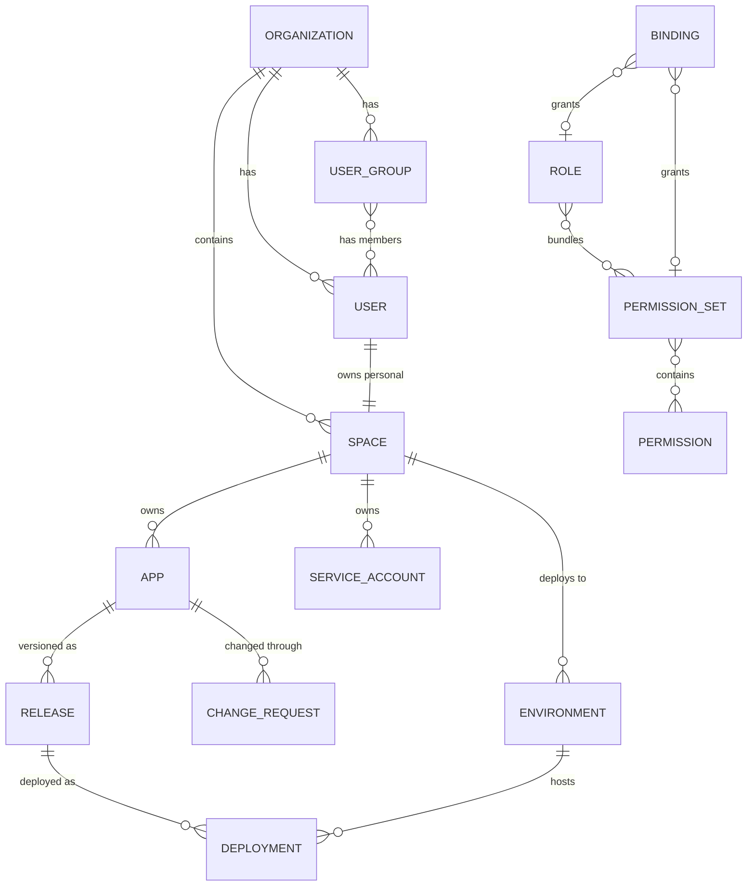
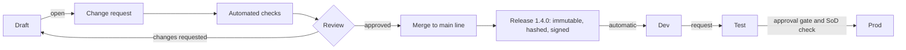
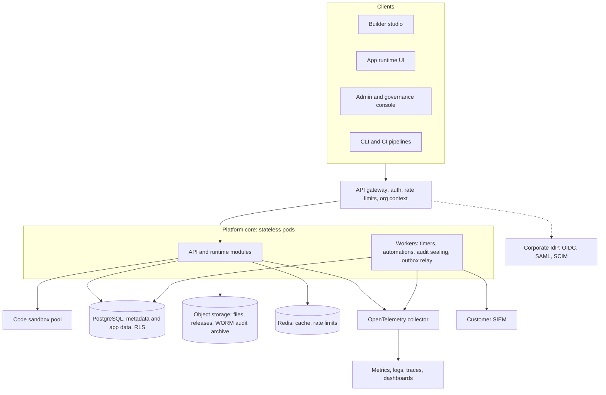

# Platform design: a governed, multi-user low-code platform

> **Status:** draft v0.1 for discussion · 2026-11-14
> **Companion:** [01-joget-review.md](01-joget-review.md), which covers what we learned from Joget DX 9.1 and why this design differs.
> **Ambition:** surpass Joget DX and be fit for enterprise use, rather than clone it.
> **Name:** "the platform" is a placeholder. Pick your own name and don't reuse the Joget trademark.

## TL;DR

- **Surpass, don't clone.** Match Joget's builder breadth, beat it on governance, isolation, delivery, observability and audit, and include security in every edition (§1).
- **Modern, proven stack:** TypeScript end to end (React builders and a NestJS modular monolith), PostgreSQL, Temporal for long-running processes, OpenTelemetry and Kubernetes (§12).
- **Build the governance kernel first:** organizations, spaces, identity, one authorization engine and an audit pipeline. Joget attaches permissions to each component, and retrofitting them is the most expensive change a low-code platform can face.
- **Two kinds of space.** Every user gets a private **personal space** with no ceremony but limited reach. Teams work in **team spaces**, which have members, Dev/Test/Prod environments, change requests and approvals. An app moves from a personal space to a team space through an audited *promotion*.
- **Permissions are permission sets bound at a scope.** Atomic permissions are grouped into reusable **permission sets**. Permission sets are composed into **roles**. Both are granted through **bindings**, which record who gets what, where, and until when. Org-level **guardrails** can only deny. One policy decision point (PDP) answers every request, whether it comes from the API, the UI, the workflow engine or custom code.
- **Deploying means flipping a pointer.** Each app change becomes an immutable, hashed **release**. Deploying it applies a reviewed migration plan and switches the environment's active version. That takes seconds, needs no restart, and rolls back instantly. The platform itself runs as stateless containers.
- **Observable and auditable by construction.** Every request carries OpenTelemetry org, space, app and env attributes. Every state change writes an audit event in the same database transaction, and the events are sealed in signed hash batches on WORM storage.

---

## 1. Goals, positioning, principles

### Goals

| # | Requirement | Definition of done |
|---|---|---|
| G1 | Multi-user | Thousands of users and hundreds of teams build and use apps at the same time; every object is isolated by organization and space |
| G2 | Roles | Predefined, customizable roles at org, space and app level, with a clear split between *building*, *operating*, *using* and *auditing* |
| G3 | Personal space | Every user automatically gets a private space to build and try things in, with limits that stop it becoming shadow production |
| G4 | Team space | Shared spaces with membership, roles, environments and change control |
| G5 | Permission sets | Reusable, named, versioned permission bundles that can be assigned, with expiry, to users, groups and service accounts |
| G6 | Well governed | Preventive guardrails, separation of duties, an owner for every app, access reviews, data classification, quotas |
| G7 | Deploy efficiently | App deploys in seconds without restarts, promotion across environments, instant rollback, a CI/CD API, zero-downtime platform upgrades |
| G8 | Monitoring | Platform SLOs; health, workflow and automation monitoring for each space and app; alerting; usage metering |
| G9 | Auditable | Every security-relevant action records who, what, when, where, why, and before/after. The log is tamper-evident, searchable and exportable, and can stream to a SIEM |
| G10 | Enterprise-grade | Meets the readiness targets below for availability, disaster recovery, security, compliance, accessibility and operations |
| G11 | Surpass Joget | Matches Joget's builder breadth (the parity list below) and beats it on every row of the comparison below |

### Where this surpasses Joget

The left column summarizes the [review](01-joget-review.md) of Joget DX 9.1: the Community Edition, with Enterprise features noted where Joget's own pages list them.

| Area | Joget DX 9.1 | This platform |
|---|---|---|
| Workspaces | None: every app is global to the instance | Personal and team spaces as first-class scopes (§3) |
| Roles | 4 fixed roles. Per-app delegation works by temporary admin elevation | Custom, scoped roles built from permission sets, with SoD, JIT elevation and access reviews (§5) |
| App permissions | Inline rules on each menu, form and list. The API uses a different model | One model for the UI, API, workflow and code, with record- and field-level rules and permission diffs in review (§5.5) |
| Data isolation | Global `app_fd_*` tables shared by all apps. Every column is text | Typed schemas per app and environment, declared cross-app references, classification tags (§6.4) |
| Custom code | BeanShell inside the server JVM | A capability-limited sandbox, out of process (§10) |
| Change control | Publishing flips a flag and the live version is editable. No locks, review or rollback | Drafts → change requests → checks → approvals → immutable releases (§6) |
| Schema changes | Additive DDL at runtime | Generated, reviewed, expand/contract migrations (§6.4) |
| Delivery | `.jwa` import through the console. No CLI or import API | API and CLI, signed bundles, GitOps, promotion across installations (§7.1) |
| Topology | Single WAR with a local data directory. Clustering is Enterprise-only | Stateless pods on Kubernetes, autoscaling and cells, in every edition (§7.2) |
| Monitoring | Log viewer. APM is Enterprise-only. No metrics endpoints | OpenTelemetry built in: SLOs, per-app dashboards, workflow SLAs, alerts, metering (§8) |
| Audit | Method-level trail with no outcomes, diffs, tamper evidence or retention | Structured events written in the same transaction, sealed, retained and streamed to a SIEM, plus record history (§9) |
| Identity | Unsalted MD5 hashes in the built-in directory. LDAP, MFA and password policies are Enterprise-only | Federation first (OIDC, SAML, SCIM), MFA and passkeys, scoped tokens, in every edition (§4) |
| Multi-tenancy | Database per profile. CE's single connection pool isn't built for concurrent tenants | `org_id` everywhere with RLS, and dedicated cells for stronger isolation (§7.2) |
| AI | Joget Intelligence (DX 9) | An assistant that drafts change requests and never bypasses checks or permissions (§13, phase 5) |

### Parity: what Joget already does that we must also do

Surpassing Joget on governance is worthless if builders miss features they rely on. These are table stakes:

| Capability | Phase (§13) |
|---|---|
| Form builder with rich fields: lookups and relations, subforms and grids, file and image upload, rich text, calculated fields, conditional visibility, multi-page forms, validation | 1 |
| List views with filters, sorting and bulk actions, and export (CSV, Excel, PDF) governed by `record.export` | 1 |
| Pages, menus, dashboards, themes and branding, with a responsive UI | 1–2 |
| Internationalization: UI translations, right-to-left layouts, per-app message bundles, time zones | 1–2 |
| App templates, import and export | 2 |
| An auto-generated, permissioned REST API for each app (Joget's API Builder is Enterprise-only) | 2 |
| Processes with human tasks, org-chart routing (requester, head of department, reporting line, department, group, role), parallel branches, timers and SLA escalation | 3 |
| A universal task inbox across apps, with delegation, out-of-office cover and reassignment | 3 |
| Notifications by email, Teams and Slack, with deep links | 3 |
| Connectors: REST, SOAP, databases (including Oracle and SQL Server), webhooks in and out, inbound email, scheduled jobs | 3 |
| Document generation (PDF from templates) | 3 |
| An installable PWA with offline drafts | 5 |
| A marketplace of signed templates and plugins | 5 |

### Enterprise readiness targets

These are initial targets, to validate with load tests and early customers:

| Area | Target |
|---|---|
| Availability | 99.9% monthly for the app runtime (99.95% with multi-zone deployment). No single point of failure. Zero-downtime upgrades |
| Disaster recovery | RPO ≤ 5 minutes (continuous WAL archiving), RTO ≤ 1 hour. Cross-region backups, with restore drills every quarter |
| Scale per cell (design target) | 50,000 users, 5,000 concurrent sessions, 2,000 apps and 100 million records. Scale beyond that by adding cells |
| Performance | Runtime API p95 under 300 ms for single-record reads and writes. Deploy and rollback in under 30 seconds |
| Security | OWASP ASVS Level 2, and Level 3 for authentication and access control. TLS 1.2+ and encryption at rest. Customer-managed keys for dedicated cells, and field-level encryption for `Restricted` data. Signed images and SBOMs, an annual penetration test, and patch SLAs for critical vulnerabilities |
| Compliance | The product produces its own evidence for SOC 2 Type II and ISO 27001 controls: audit log, access reviews, change records. GDPR tooling for data-subject export and erasure. Data residency through cells. Retention policies and legal holds |
| Accessibility | WCAG 2.2 AA for the builders and for generated apps |
| Operations | Runs on any conformant Kubernetes, including OpenShift (non-root, read-only root filesystem). Supports air-gapped installs (mirrored images, an offline licence, no required outbound calls). Ships runbooks and support bundles |
| Compatibility | App definitions carry a schema version and are upgraded automatically. Releases stay deployable for at least one platform major version. A documented deprecation policy |

### Non-goals for the MVP (phases 0–2)

Marketplace, native mobile apps, AI-assisted building, real-time co-editing, and a BI/reporting suite. Several of these arrive in later phases (§13), but none of them should shape the kernel.

### Principles

1. **Kernel first.** Identity, scopes, authorization and audit exist before any builder does. Builders are clients of the kernel.
2. **One authorization path.** No component has its own permission logic. The UI hides what the PDP denies, but only the PDP enforces access.
3. **Everything is scoped.** Every row and object carries `org_id` and `space_id`. Tables, apps, files and plugins have no global namespace.
4. **Definitions are data, releases are immutable, and a deploy is a pointer flip.**
5. **No change without an audit event.** The event is written in the same transaction as the change.
6. **Stateless runtime.** There is no shared filesystem and no sticky sessions. All state lives in Postgres, object storage and Redis.
7. **Custom code is sandboxed and permissioned.** It runs as a principal, never in-process with platform privileges.
8. **Secure by default.** Private by default, deny by default, least privilege, and secrets by reference only.

---

## 2. Core concepts



| Concept | Meaning |
|---|---|
| **Organization** | The top-level tenant and isolation boundary, holding users, groups, spaces, policies, the audit log and quotas. A single-company install has one org, but the key exists from day one. |
| **User / group / service account** | The principals. Users and groups usually come from the corporate IdP through SCIM. Service accounts are non-human, are owned by a space, and serve integrations and CI. |
| **Space** | A container that owns apps, connections, service accounts and environments. It is either `personal` (exactly one per user) or `team`. |
| **App** | A set of definition artifacts: data models, forms, views, pages, processes, automations, connectors and app roles. It belongs to exactly one space and has a named owner. |
| **Draft / change request** | A draft is a working copy of an app's definitions. A change request asks to merge a draft, and carries its diff, checks and approvals. |
| **Release** | An immutable, content-hashed, signed snapshot of an app's definitions, plus a manifest of its dependencies. |
| **Environment** | An isolated runtime namespace in a space, such as Dev, Test or Prod. It has its own data schema, config values, secrets, connection bindings and role-to-group mappings. |
| **Deployment** | The record of putting a release into an environment: plan, approvals, executor, result and health. |
| **Permission / permission set / role / binding** | See §5. |
| **Guardrail** | An org-level policy that can deny an action, or require something such as approvals, regardless of grants. |
| **Audit event** | An append-only record of an action. See §9. |

---

## 3. Spaces

| | Personal space | Team space |
|---|---|---|
| Created | Automatically at first login | By users holding `space.create`, or on request |
| Visible to | Only the owner. Individual apps can be shared with up to *N* named users | Members, according to their space role. App users, according to app roles |
| Environments | One **Sandbox**, where edits apply immediately | **Dev → Test → Prod**, with tiers defined by the org |
| Change control | None: the owner edits live | Change requests, reviews, approvals, releases |
| Data connections | Sample data and connections tagged `personal-allowed`. A guardrail blocks production connections | Bound per environment |
| Public/anonymous access | Never | Only with Security admin approval (a guardrail) |
| Custom code | Off by default | For holders of `code.author`, reviewed in change requests |
| Quotas | Small fixed caps on apps, records, storage and automation runs | Set for each space by org admins |
| When the owner leaves | The space is frozen. Its apps go to the manager, or are archived after a retention period | No effect: a team space must always have at least 2 owners |

### Promotion: personal → team

1. The owner chooses **Promote** and picks a target team space where they hold `change.open`.
2. The platform opens a **change request** in the target space that contains a copy of the app, with a new app ID and a lineage link to the source.
3. The target space's reviewers approve it, after the same checks as any other change: guardrails, permission diff and data classification.
4. On merge, the personal copy becomes read-only (or is archived), and its sharing links redirect to the new app.
5. Data is not copied unless that is explicitly requested, approved and classified.

Why: personal spaces stay fast and free of ceremony. Anything that outgrows "me plus a few colleagues" moves to a place with owners, environments and change control. A guardrail can also *nudge* the owner, for example: "this personal app has 12 users, consider promoting it".

### Space lifecycle

`active → frozen (read-only) → archived → deleted (after retention)`. Every transition is audited, and deletion honours legal holds.

---

## 4. Identity

- **Federation first.** The platform signs users in through OIDC (preferred) or SAML against the corporate IdP: Entra ID, Okta, Google or Keycloak. It does not store corporate passwords.
- **SCIM 2.0** provisions users and groups. Deprovisioning revokes sessions and tokens immediately and freezes the user's personal space.
- **Local accounts** exist only for small installs and break-glass access, with a password policy, MFA (TOTP or WebAuthn/passkeys) and lockout.
- **Groups** are either synced from the IdP (read-only on the platform) or managed on the platform and owned by a space.
- **Service accounts** are owned by a space and have no interactive login. They get short-lived tokens through client credentials or workload identity federation.
- **Personal access tokens** carry a scoped subset of the user's own permissions and have a maximum TTL (for example 90 days). Admins can see and revoke them. Effective permissions are the intersection of the user's permissions and the token's scopes.
- **Sessions** use short-lived access tokens, rotating refresh tokens, idle and absolute timeouts, and server-side revocation.
- **Step-up MFA** is required for sensitive actions: deploying to Prod, changing bindings or guardrails, exporting data, and break-glass.
- **Impersonation** ("view as") is for support only. It is time-boxed, needs a justification, is visible to the impersonated user, is audited with `on_behalf_of`, and is read-only by default.

---

## 5. Authorization: roles, permission sets, bindings

### 5.1 Building blocks

| Concept | What it is | Example |
|---|---|---|
| **Permission** | An atomic verb on a resource type | `app.edit`, `deploy.approve`, `record.export` |
| **Permission set** | A reusable, named, versioned bundle of permissions, optionally with conditions. It can only add permissions | "Release management" = `release.create`, `deploy.request`, `deploy.read` |
| **Role** | A job function made of one or more permission sets, intended for one scope type | "Release manager" (space scope) = Release management + App read |
| **Binding** | Grants a role *or* a permission set to a principal at a scope, with an optional expiry, justification and approver | Alice → Release manager @ space *Finance*, until 2027-03-31 |
| **Guardrail** | An org-level rule that denies or requires something, overriding grants | "Prod deploys need 2 approvals and a passing check run" |

Admins assign roles day to day. Permission sets are the building blocks, and can also be granted directly for exceptions such as "Bob may export Expense records until Friday". This mirrors the role-plus-permission-set model that large SaaS platforms have converged on, and the Role/RoleBinding split in Kubernetes.

### 5.2 Scope hierarchy

```text
org ──▶ space ──▶ app ──▶ environment
```

A binding applies to its scope and everything below it. **Exception:** personal spaces do not inherit org-level roles, apart from the administrative permissions `space.freeze` and `space.transfer`. For an admin to read personal-space content takes break-glass access, which is time-boxed, justified, notified and audited.

### 5.3 Platform permission catalog (excerpt)

| Resource | Permissions |
|---|---|
| Org | `org.settings.manage`, `org.guardrail.manage`, `org.audit.read`, `org.audit.export` |
| Directory | `directory.user.manage`, `directory.group.manage`, `directory.service_account.manage` |
| Access | `access.binding.manage`, `access.permission_set.manage`, `access.review.run`, `access.breakglass.activate` |
| Space | `space.create`, `space.read`, `space.settings.manage`, `space.member.manage`, `space.freeze`, `space.transfer`, `space.delete` |
| App definition | `app.create`, `app.read`, `app.edit`, `app.share`, `app.export`, `app.delete` |
| Change | `change.open`, `change.review`, `change.approve`, `change.merge` |
| Release / deploy | `release.create`, `deploy.request`, `deploy.approve`, `deploy.execute`, `deploy.rollback` |
| Environment | `env.config.manage`, `env.secret.write` (write-only: secret values are never readable), `env.binding.manage` |
| Connection | `connection.use`, `connection.manage` |
| Extensibility | `code.author`, `plugin.install`, `plugin.approve` |
| Operations | `ops.monitor.read`, `ops.job.retry`, `ops.task.reassign` |
| Runtime data (per entity) | `record.read`, `record.create`, `record.update`, `record.delete`, `record.export` |
| Workflow (per process) | `process.start`, `task.claim`, `task.complete`, `task.reassign`, `process.admin` |

### 5.4 Default roles (managed by the platform; orgs can clone and customize them)

| Scope | Role | Gist |
|---|---|---|
| Org | **Org owner** | Everything at org scope. At least 2 required |
| Org | **Org admin** | Users, groups, spaces, settings. **No access to runtime data by default** |
| Org | **Security admin** | Guardrails, permission sets, access reviews, approving break-glass |
| Org | **Auditor** | Read-only access to the audit log, configuration and bindings. Cannot be combined with any admin role |
| Org | **Platform operator** | Monitoring, platform health, job retries. No app data |
| Space | **Space owner** | Everything in the space. At least 2 required in a team space |
| Space | **Space admin** | Members, settings, environment config, role-to-group mappings |
| Space | **Builder** | Edits drafts, opens change requests, deploys to Dev |
| Space | **Reviewer** | Reviews and approves change requests |
| Space | **Release manager** | Cuts releases, requests and executes deployments (Prod still needs approval) |
| Space | **Operator** | Monitors apps, retries automations and reassigns tasks in its environments |
| Space | **Viewer** | Reads app definitions and monitoring |
| App | *(defined by builders)* | For example Requester, Approver, App admin. See §5.5 |

**Space roles govern building and operating; app roles govern using.** People who only use an app never need to be space members.

### 5.5 Permissions inside apps

Builders define **app roles as permission sets over the app's own entities and processes**:

- **Entity level:** `record.read|create|update|delete|export` for each entity.
- **Record level:** conditions such as *owner is me*, *assigned to me*, *same department as me*, or a predicate on a field. Conditions are written in a safe expression language (CEL) and compiled to SQL filters.
- **Field level:** each field can be hidden, read-only or masked per role. Fields tagged `PII` are masked unless a role explicitly unmasks them.
- **Process level:** who may start a process, which role each human task is assigned to, and who may reassign tasks.
- **The UI follows the data.** Pages, menus and buttons are shown according to the same permission sets, so there is no separate "menu permission" to forget. If a role cannot `record.read` an entity, its page is hidden **and** its API is denied.

App roles are bound to groups **per environment**, for example *QA testers* in Test and *Finance approvers* in Prod. These mappings belong to the environment, only Space admins can change them, and every change is audited.

```yaml
# permissions/approver.yaml: an example app permission set
name: Approver
entities:
  expense_claim:
    read:   { where: "record.status in ['submitted', 'approved'] && record.department == principal.department" }
    update: { where: "record.status == 'submitted'", fields: [status, approver_comment] }
    export: false
  employee:
    read:   { fields: { exclude: [bank_account] } }
processes:
  expense_approval:
    tasks: [approve_claim]
```

### 5.6 Guardrails (org level)

Guardrails are rules that deny an action or require something before it. They are evaluated at design time (in the builder), at merge time (on change requests) and at run time. Examples:

- Pages with anonymous access cannot reach Prod without Security admin approval.
- Fields tagged `PII` must be masked in views and are excluded from exports by default.
- Personal spaces cannot bind connections tagged `production`.
- A change that contains custom code needs a reviewer from the *Platform engineering* group.
- A Prod deployment needs 2 approvals and a green check run, and can optionally be limited to a change window.
- Records of entities tagged `retention:7y` cannot be hard-deleted.

### 5.7 Separation of duties, just-in-time access, reviews

- **Separation-of-duties (SoD) constraints** are checked when a binding is created, for conflicting roles such as Auditor plus Org admin. They are checked again when an action runs: the author of a change can neither approve it nor approve its Prod deployment.
- **Just-in-time elevation:** a sensitive role such as Prod operator can be *eligible* rather than active. Activating it takes a justification (and optionally an approval), lasts a few hours at most, and is audited.
- **Access reviews:** scheduled campaigns ask space owners to re-certify their members and bindings, and anything not confirmed expires automatically. Bindings unused for 90 days are flagged.
- **Expiry everywhere:** bindings, tokens and shares can all carry `expires_at`, and temporary grants are the default for exceptions.

### 5.8 Decision algorithm and enforcement points

```text
authorize(principal, action, resource, context) -> Decision{allow|deny, reasons[]}
  1. principal  := user + transitive groups (or a service account), intersected with token scopes
  2. chain      := scope chain of the resource: env → app → space → org (personal spaces stop at space)
  3. bindings   := the principal's active, unexpired bindings on any scope in the chain
  4. grants     := bindings → roles → permission sets → permissions (+ conditions)
  5. allow      := some grant matches the action and its condition holds (record, field, context)
  6. guardrails := org guardrails for the action; any deny or unmet requirement → deny, with a reason
  7. step-up    := a sensitive action with MFA older than N minutes → deny(reason = step_up_required)
  8. audit      := always for sensitive actions and denials; sampled for routine allows
```

Every enforcement point calls the same PDP:

1. **API layer.** Every endpoint declares its `(action, resource)`. A test fails if any route lacks a declaration, so no endpoint can be left unprotected.
2. **Data layer.** List and search queries receive row filters and field masks generated by the PDP. **Postgres row-level security** enforces `org_id` isolation as defence in depth.
3. **Workflow engine.** Claiming, completing and reassigning tasks are authorized actions.
4. **Sandbox.** Custom code calls platform APIs with a token for the invoking principal (or the app's service account), never as a superuser.
5. **UI.** Hides what the PDP denies. This is for usability only and is not a security boundary.

Every decision is **explainable**, for example "allowed by binding B via permission set P" or "denied by guardrail G". That powers an admin tool that answers *"Why can, or can't, this user…?"*, and it feeds the audit trail.

### 5.9 Storage sketch

```sql
create table permission_set (
  id          uuid primary key,
  org_id      uuid not null,
  name        text not null,
  scope_type  text not null check (scope_type in ('org', 'space', 'app', 'env')),
  version     int  not null default 1,
  managed     boolean not null default false
);

create table permission_set_item (
  permission_set_id  uuid not null references permission_set,
  permission         text not null,                -- 'deploy.approve', 'record.read', ...
  resource_selector  text not null default '*',    -- e.g. an entity name inside an app
  condition          text,                         -- CEL expression, null = unconditional
  primary key (permission_set_id, permission, resource_selector)
);

create table role (
  id uuid primary key, org_id uuid not null,
  name text not null, scope_type text not null, managed boolean not null default false
);

create table role_permission_set (
  role_id            uuid not null references role,
  permission_set_id  uuid not null references permission_set,
  primary key (role_id, permission_set_id)
);

create table binding (
  id                 uuid primary key,
  org_id             uuid not null,
  principal_type     text not null check (principal_type in ('user', 'group', 'service_account')),
  principal_id       uuid not null,
  role_id            uuid references role,
  permission_set_id  uuid references permission_set,
  scope_type         text not null,
  scope_id           uuid not null,
  expires_at         timestamptz,
  justification      text,
  granted_by         uuid not null,
  approved_by        uuid,
  created_at         timestamptz not null default now(),
  check ((role_id is null) <> (permission_set_id is null))   -- exactly one of the two
);

-- On every table:
--   alter table binding enable row level security;
--   create policy org_isolation on binding using (org_id = current_setting('app.org_id')::uuid);
```

With bindings stored relationally, governance questions are cheap to answer: *"Who can deploy to Finance Prod?"* is a query, not a code audit. Keep the PDP behind an interface, so that a Zanzibar-style engine (OpenFGA, SpiceDB) or Cedar can replace the evaluator later if sharing graphs get complex.

---

## 6. App model and governed change

### 6.1 What an app is made of

This keeps Joget's proven breakdown of an app, but uses one permission model and typed data:

| Artifact | Joget equivalent | Notes |
|---|---|---|
| Entity (data model) | A form and its `app_fd_*` table | Typed fields, relations, constraints, classification tags (`PII`, `Confidential`) |
| Form | Form | Layout and validation, bound to an entity |
| View | Datalist | Columns, filters, actions |
| Page / navigation | Userview | Visibility derived from permissions |
| Process | Process (XPDL) | A BPMN-style model (start, human and service tasks, gateways, timers, end), run durably on Temporal |
| Automation | Process tools, plugins | Triggered by record events, schedules or webhooks |
| Connector | Plugins, API connectors | Declarative HTTP, database or queue connections; secrets by reference |
| App roles | Userview/form permission plugins, participant mappings | Permission sets (§5.5) |
| Settings | Environment variables | Values set per environment |
| Translations | Message bundles | |

### 6.2 Definition format

Each app is a tree of JSON/YAML documents, validated against published JSON Schemas. That makes the definitions readable, diffable and exportable to Git:

```text
expense/
  app.yaml                    # id, owner, classification, dependencies, required connections and secrets
  entities/expense_claim.yaml
  forms/claim_form.json
  views/my_claims.json
  pages/navigation.json
  processes/expense_approval.yaml
  automations/notify_finance.yaml
  connectors/erp.yaml
  permissions/requester.yaml
  permissions/approver.yaml
  i18n/en.json
  tests/approval_flow.yaml    # optional scenario tests
```

The platform stores definitions in Postgres, with drafts held as copy-on-write over the main line, and stores release bundles in object storage. **Git sync** (push to GitHub or GitLab, and optionally pull) is an export and integration feature, not the runtime's source of truth, so the runtime never needs a shared filesystem.

### 6.3 Lifecycle in a team space



Rolling back means re-activating the previous release in that environment (§7.1).

**Checks on every change request:**

- Schema validation and reference integrity: no broken links between forms, views and processes.
- Lint: naming conventions, unused fields, missing labels or translations.
- Guardrails (§5.6).
- **Permission diff:** a plain-language summary of who gains or loses access to what, for example "*Approver* can now export *Expense claim*".
- A **migration plan** for data-model changes, with destructive steps flagged.
- Scenario tests, where present.

**Concurrency.** Each builder (or each change) has its own draft. Artifacts carry versions for optimistic locking, merges are three-way at the artifact level, and conflicts are shown in the UI. Real-time co-editing can come later.

### 6.4 Data-model migrations

App data lives in **typed tables, in a separate schema for each app and environment** (for example `app_7f3c_prod`). Nothing is shared implicitly between apps: one app reaches another's data only through declared, permissioned references.

| Model change | Migration | Gate |
|---|---|---|
| Add an entity, field or index | Applied directly | Normal |
| Rename a field | Expand/contract: add the new column, backfill it, switch reads, and drop the old column in a later release | Normal |
| Change a type, or drop a field or entity | Destructive | Explicit approval and an automatic snapshot first. Blocked if the entity has a `retention` tag |

Migrations are generated from the model diff, reviewed in the change request, and executed by the deployment. Saving in a builder never runs them.

### 6.5 Process versioning

Running process instances stay on the release they started on, while new instances use the active release. Migrating in-flight instances is an explicit, audited operation with a dry run.

---

## 7. Deployment

### 7.1 Deploying apps (seconds, no restarts)

Deploying release *R* to environment *E* runs these steps:

1. **Plan.** Diff R against E's active release to get the migrations, permission changes, config and secret requirements, and dependency checks (plugins and connections present in E).
2. **Approve,** as the guardrails require: for example automatically for Dev, 1 approval for Test, and 2 approvals plus SoD for Prod.
3. **Execute.** Apply the migrations (expand phase), warm caches and run smoke checks.
4. **Activate.** Switch E's active-release pointer in one transaction. Runtime nodes pick up the change through a cache-invalidation event.
5. **Verify.** Watch error rate and latency for a short window, and roll back automatically on a breach.
6. **Roll back** by re-activating the previous release. The expand/contract discipline keeps the previous release compatible with the data.

Target: deploys and rollbacks that touch only metadata finish in under 30 seconds.

**Across installations**, such as an isolated Prod cluster, export a signed release bundle and import it through the API or CLI. The target verifies the signature and the approval record. Alternatively, it can pull releases GitOps-style.

**CI/CD.** Everything in the UI is also available through the API and a CLI. An illustrative command:

```bash
platform deploy --space finance --app expense --release 1.4.0 --env test --wait
```

### 7.2 Deploying the platform



- **Packaging:** signed OCI images with SBOMs, and one Helm chart. Small and evaluation installs use Docker Compose with the same images.
- **Stateless pods** sit behind the gateway and autoscale horizontally. Workers scale on queue depth.
- **Database:** managed PostgreSQL, or PostgreSQL under an operator such as CloudNativePG, with point-in-time recovery and read replicas for reporting.
- **Zero-downtime upgrades:** rolling deploys, readiness probes, pod disruption budgets, expand/contract schema migrations (Drizzle) and feature flags.
- **Platform delivery:** CI builds, tests, scans and signs the images. GitOps (Argo CD or Flux) then promotes them through the platform's own dev → staging → prod.
- **Cells for scale and isolation.** A *cell* is a complete platform stack with its own database, and each org is assigned to a cell. Regulated customers, or those with data-residency needs, get a dedicated cell. Cells limit the blast radius of incidents and noisy neighbours.

---

## 8. Monitoring

Three audiences share one pipeline: OpenTelemetry → collector → Prometheus, Loki, Tempo and Grafana (or a vendor).

| Audience | What they see |
|---|---|
| Platform operators | SLOs (availability, p95 latency), saturation, database health, queue depth, sandbox health, a dashboard per cell |
| Space owners and operators | For each app and environment: requests, errors, latency, active users, failed automations (with retry and replay), connector health, deployment history |
| Process owners | Running instances, task backlog and age, SLA breaches and bottleneck steps, with the ability to reassign stuck tasks |

- **Attributes on every span and log:** `org.id`, `space.id`, `app.id`, `app.release`, `env`. Metrics carry org, space, app and env but **not** user IDs, for cardinality and privacy. User IDs appear only in traces and logs, where policy allows.
- **Example metrics:** `app_requests_total`, `app_request_duration_seconds`, `workflow_tasks_open`, `workflow_task_age_seconds`, `automation_runs_total{status}`, `connector_calls_total{status}`, `authz_decisions_total{decision}`, `deployments_total{result}`.
- **Alerting:** SLO burn-rate alerts go to operators. Owner-facing alerts (error spikes, failed automations, SLA breaches) go out by email, Teams or Slack.
- **Usage metering** for each space and app (records, storage, automation runs, API calls) feeds quotas, chargeback and detection of unused apps.
- **Health:** liveness and readiness endpoints, plus synthetic login and app checks.

---

## 9. Audit

### 9.1 What is recorded

| Category | Events |
|---|---|
| Authentication | Login success and failure, MFA, logout, token creation/use/revocation, SCIM provisioning |
| Access control | Changes to bindings, roles, permission sets and guardrails; access reviews; JIT elevation; break-glass; **denials** |
| Configuration | Changes to orgs, spaces, environments, connections and secret metadata (secret values are never logged) |
| App lifecycle | Draft edits (summarized), change requests, reviews, approvals, merges, releases, deployments, rollbacks |
| Runtime data | Creates, updates and deletes with field-level diffs (configured per entity); reads and exports of classified data |
| Workflow | Process starts, task assignment, claim, completion (with the decision and comment), reassignment, escalation |
| Support | Impersonation sessions, and everything done in them |

### 9.2 Event shape

```sql
create table audit_event (
  seq          bigint generated always as identity,   -- total order within a cell
  id           uuid not null,                         -- UUIDv7
  occurred_at  timestamptz not null,
  org_id       uuid not null,
  space_id     uuid,
  app_id       uuid,
  env          text,
  actor        jsonb not null,  -- {type, id, via: ui|api|cli|system, session_id, token_id, on_behalf_of}
  action       text  not null,  -- from the action catalog, e.g. 'binding.create', 'deploy.approve'
  target       jsonb,           -- {type, id, name}
  outcome      text  not null,  -- success | denied | error
  reason       jsonb,           -- decision basis, change request id, justification
  changes      jsonb,           -- before/after diff, secrets redacted
  context      jsonb,           -- ip, user agent, request id, trace id
  content_hash bytea not null,  -- sha-256 of the canonical event
  primary key (occurred_at, seq)
) partition by range (occurred_at);
```

### 9.3 Integrity and delivery

- **Same transaction.** The audit row is written in the same database transaction as the change it describes (a transactional outbox), so no change can commit without its audit event.
- **Append-only.** The application's database role has `INSERT` and `SELECT` only, with no `UPDATE` or `DELETE`. Old partitions are detached and archived, never edited.
- **Tamper evidence.** Every minute, a sealer job batches the new events and computes a Merkle root over their hashes, chained to the previous seal. It signs the root with a KMS key and writes the seal to WORM object storage (for example S3 Object Lock in compliance mode). A verifier can recompute any range.
- **Streaming.** An outbox relay ships events to long-term storage and to the customer's SIEM over syslog, HTTPS or OTLP logs.

### 9.4 Record history

History can be turned on for each entity. Every change then stores a field-level diff with the actor, the time, the source (form submit, workflow task, API or automation) and a link to the audit event. Forms show a **History** tab. Restoring an old value creates a new change rather than rewriting history.

### 9.5 Access and retention

- **Auditors** can search and export everything in their org. **Space owners** see their own spaces. **Users** see activity in their personal space and on records they own. Exports are themselves audited.
- Retention is set per org (for example 1–7 years), with support for legal holds. Audit events reference users by a stable ID and personal details are resolved from the directory at read time, so erasure requests can be honoured without breaking the hash chain.

---

## 10. Extensibility and safe custom code

| Tier | Used for | Safety |
|---|---|---|
| Declarative | Validation, calculated fields, conditions, routing rules | **CEL** expressions, which are non-Turing-complete, free of side effects and cheap to evaluate |
| Sandboxed scripts | Custom logic in automations and connectors | Run in a separate sandbox (WebAssembly or an isolated JS runtime) with CPU, memory and time limits, no filesystem, an egress allowlist, secrets through a broker, and a principal's identity. Need `code.author` and review |
| Plugins | New field types, connectors, themes | Signed packages that a Security admin approves and allowlists for each org. Versions are pinned in each release; out-of-process where possible |

Joget's equivalent of the middle tier is BeanShell code running inside the server's JVM with full platform access (see the review, §4.8). It is the single biggest governance gap to avoid.

---

## 11. Logical architecture

Start as a **modular monolith**: one deployable unit with strict module boundaries. Split out services only when scale demands it. The workflow workers, the audit pipeline and the sandbox are the first candidates.

| Module | Owns |
|---|---|
| Identity and directory | Users, groups, service accounts, tokens, SCIM, sessions |
| Access control | Permissions, permission sets, roles, bindings, guardrails, SoD, JIT elevation, access reviews, the PDP |
| Spaces and catalog | Orgs, spaces, membership, the app registry, ownership, quotas |
| Definitions | Artifacts, drafts, change requests, checks, diffs |
| Releases and deployments | Releases, environments, plans, approvals, migrations, activation |
| Runtime | The data API, form/view/page metadata, record and field security |
| Workflow and automation | The process engine, human tasks, timers, SLAs, triggers |
| Integrations | Connectors, the plugin host, the secrets broker, the sandbox client |
| Audit | Capture, sealing, query, export, SIEM streaming |
| Observability and usage | Telemetry conventions, health, metering |
| Notifications | Email, chat, in-app |

---

## 12. Reference stack (recommended default)

"Modern" here means the architecture first: stateless services, declarative definitions, API-first design, OpenTelemetry, sandboxed code and GitOps, all on proven infrastructure (PostgreSQL, Kubernetes, S3). Joget DX 9.1 already runs on current Java and Spring. What dates it is its architecture ([review §4](01-joget-review.md#4-findings-by-area)), not its language.

Within that, **TypeScript end to end** is the recommended default. A low-code platform is mostly a metadata platform, and TypeScript lets the builders, the runtime, the API, the CLI and the sandbox share the same app-definition schemas.

| Concern | Choice | Why |
|---|---|---|
| Language | TypeScript everywhere, on Node.js (current LTS) | One type system for app definitions across builders, runtime, API and CLI. JSON-native, with a large talent pool |
| Repository | A pnpm workspaces + Turborepo monorepo | Shared packages with enforced boundaries, and fast incremental builds |
| Definition schemas | Zod schemas, exported as JSON Schema | Definitions validate identically in the browser, on the server and in the CLI |
| Frontend | React 19, Vite, TanStack Router and Query, and Tailwind CSS with shadcn/ui (Radix primitives) | Accessible components for the builders and for generated apps |
| Builders | dnd-kit for the form and page canvases; React Flow (xyflow) for the process designer | MIT-licensed building blocks for our own designers |
| Backend | NestJS on Fastify, organized as a modular monolith | Its modules map onto §11, its guards host the PDP enforcement point, and it generates OpenAPI |
| API | REST with OpenAPI 3.1, a generated TypeScript SDK, and webhooks | Serves CI/CD and integrations. The CLI is built on the same SDK |
| Database | PostgreSQL 17+ (RLS, JSONB). Drizzle ORM and migrations for platform tables; generated SQL for app schemas | One reliable store for metadata, app data and audit |
| Jobs and outbox | graphile-worker, which is Postgres-backed and enqueues jobs in the same transaction as the change | No message broker needed early on. Add Kafka only if volume demands it |
| Processes | Temporal (TypeScript SDK), running an interpreter workflow for our process model, from phase 3 | Durable timers, SLAs, retries and version pinning, without writing a workflow engine |
| Expressions | A CEL subset, parsed in TypeScript and compiled to SQL for record rules | One safe language for permissions, validation and routing |
| Sandbox | A separate service that runs JavaScript in WebAssembly (QuickJS), with CPU, memory and time limits | Custom code cannot touch the platform process |
| Cache | Valkey (Redis-compatible) | Permission caches, rate limits, presence |
| Identity | The corporate IdP over OIDC or SAML, with Keycloak bundled for self-hosted installs | Federation, MFA and passkeys without building them |
| Files | S3-compatible object storage | Files, release bundles, the WORM audit archive |
| Observability | OpenTelemetry JS SDK and Pino structured logs → OpenTelemetry Collector → Prometheus, Loki, Tempo, Grafana | Vendor-neutral |
| Testing | Vitest, Playwright, Testcontainers | Unit tests, end-to-end tests, and integration tests against a real Postgres |
| Delivery | GitHub Actions, signed images (cosign), SBOMs, Helm, Argo CD | Repeatable, auditable platform deploys |

**Alternatives, if your team's skills point elsewhere:**

- **Go** for hot paths such as the gateway or the sandbox host (wazero runs WebAssembly natively in Go), if profiling ever shows that Node.js is the bottleneck.
- **Java 21 or Kotlin, with Spring Boot 3 and Flowable,** if the team is Java-first and needs full BPMN 2.0 conformance. Modern Java is not "legacy"; it just can't share types with the builders.

Check each component's licence as you adopt it. Prefer Apache-2.0 and MIT, and record the decision.

---

## 13. Roadmap

| Phase | Scope | Exit criterion |
|---|---|---|
| **0. Governance kernel** | Orgs, personal and team spaces, membership · OIDC login, directory, service accounts, tokens · the PDP with permission sets, roles, bindings and expiry · RLS isolation · the audit pipeline (same-transaction writes, sealing) · OpenTelemetry conventions · CI/CD, Helm chart, Compose file | An admin creates a team space and assigns roles, and every action appears in a verifiable audit log |
| **1. Minimum builder** | Entities, forms, views, pages · personal-space sandbox (edit live) · runtime data API with record- and field-level permissions · record history | A user builds a working app in their personal space and shares it with two colleagues |
| **2. Governed delivery** | Team-space environments · drafts and change requests with checks and permission diffs · releases, deployment plans, migrations, approvals, rollback, CLI/API · promotion from personal to team · an auto-generated, permissioned REST API for each app · app templates, import and export | A change goes Dev → Test → Prod with approvals and is rolled back in under a minute |
| **3. Workflow and automation** | Processes on Temporal, human tasks, universal inbox, org-chart routing, timers and SLAs · automations and connectors · notifications · document generation · workflow monitoring | An approval process runs end to end with SLA alerts and a complete audit trail |
| **4. Enterprise hardening** | Guardrail editor, SoD, JIT elevation, access reviews · plugin registry, sandboxed scripts · SIEM streaming, quotas and metering · dedicated cells with customer-managed keys · DR drills, ASVS verification and a penetration test | Passes an internal audit against your chosen control framework (for example ISO 27001 or SOC 2) and meets the readiness targets in §1 |
| **5. Beyond parity** | An AI assistant that drafts definitions and change requests within the user's own permissions · a signed marketplace of templates and plugins · an installable PWA with offline drafts · a BI connector (read replica, governed exports) | A business user describes an app, reviews the AI-drafted change request, and ships it through the normal approval flow |

Phases 0–2 are the MVP. Phase 0 comes first on purpose: users never see it, but everything else depends on it.

---

## 14. Open decisions

1. **Who are the tenants?** Either one company (a single org, with spaces doing the separating) or a SaaS for many companies (several orgs, cells, billing). The design supports both, but the MVP scope differs.
2. **Team skills:** TypeScript end to end is the recommended default (§12). Does your team's experience, for example strong Java or Go, change that?
3. **Hosting:** your cloud, customers' on-premises servers, or both? This affects packaging, promotion into air-gapped environments, and the default IdP.
4. **Workflow depth:** is a BPMN-style subset enough, or do you need full BPMN 2.0 conformance, for example to import existing process models?
5. **Compliance target:** which framework (ISO 27001, SOC 2, sector rules, data residency) sets audit retention and evidence requirements?
6. **Fork or build:** decided on 2026-11-14: build new ([review §6](01-joget-review.md#6-fork-or-build)).
7. **Platform database:** PostgreSQL only for the platform's own store (recommended; enterprise databases such as Oracle and SQL Server are reached through connectors), or must the platform itself run on other databases?
8. **Editions:** keep security and governance features in every edition, and differentiate paid tiers on scale, support and dedicated cells?
